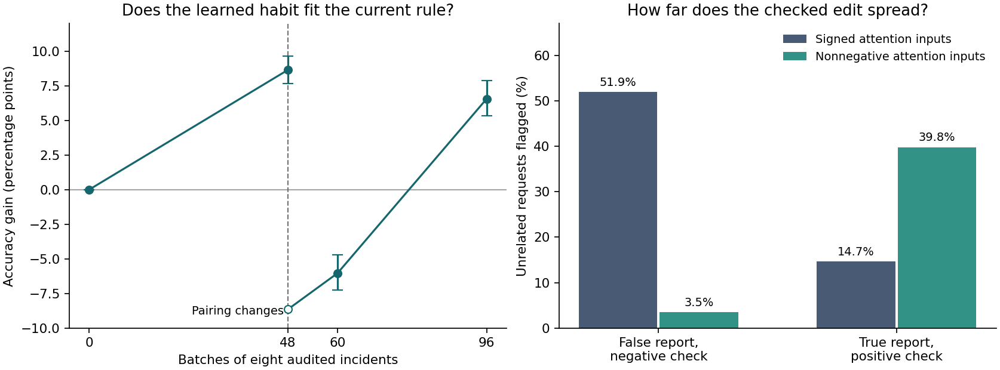

# Does experience change where a gradient goes?

A weight update learned to reach the request types that had historically changed together. When those relationships switched, the old habit initially hurt. Separately, strengthening a correct negative check sometimes made unrelated requests look more likely to have changed. The direction of the attention update explains this behavior; constraining it trades one type of spillover for another. On real preference judgments a conventional covariance model remained stronger.



The left panel compares each model with the fork that received the other history. The open point evaluates the existing weights under the just-changed pairing. The right panel shows total remaining errors on unrelated queries after the second observation, at four times the ordinary checked update.

The [next study](conditional-writes.md) tests whether the writer can learn when to use an opposite direction, and checks for corresponding sign reversals in a second population of human raters.

## Protocol fixed before training

Start two small transformers from the same language training and give them the same human-written requests. In one service, intents A and B historically changed their routing together. In another, A changed with a different partner. No pair names or rules are model inputs. The question is whether the *same* correction now changes an internal attention weight in a way that helps the right other requests, and whether that habit can be revised when it stops helping.

Use ten independent training seeds 1101–1110, one per CLINC150 domain, with six sampled intents each. Train a small word-level transformer to recognize the six intents on the official training split. Keep official test wording separate throughout. Add a final classification-token attention operation whose value-projection matrix starts at zero for every new incident. A fixed negative bias says nothing changed before observations arrive. This makes baseline logits identical by construction even when historical weights differ. The score concerns whether routing changed relative to the existing assignment; the previous queue is assumed known. A gradient on an example changes the value matrix, and subsequent requests are scored with those new weights. Save and reload a complete learner after a correction; predictions must survive clearing the evidence. Compare the implemented update directly to automatic differentiation.

Practice minimizes query error after ordinary gradient updates on a small support set, by differentiating through the updates. Each practice incident is stable or changes one historical pair. The two matched histories have disjoint pairings, swap them at the midpoint without a signal, and receive the same examples and error draws. A third learner sees random pairings every incident with matched event sizes. Record checkpoints before practice, after 48 minibatches, after 12 minibatches under the new regime and after 48 under the new regime. Each minibatch has eight independent practice incidents. Use separate test support and query wordings, shared across every comparison. Test new combinations that change two pairs at once, alongside single-pair and stable incidents. Include budgets of 1, 2, 4 and 8 reports, with 10% independent label noise. For a simple practical reference give a Bayesian independent-change observer the six-intent recognizer from shared language training; score it on the identical evidence.

On double changes, require correctly matched histories to beat both randomly paired practice and the ordinary independent-change observer by at least three percentage points with a lower paired seed interval above zero. Report the causal history swap separately. On held-out partner queries measure how much a forced contrary report changes logits at the historical, alternative and unrelated intents. At the last checkpoint test whether the sign of the historical preference reverses. Report changes through all checkpoints and stability on no-change incidents. Test forked true and false contrary feedback with the same wording, first on its own, then with one fresh check on the peer. Test both perfect checks and 10% wrong checks, shared across models. Require excess harmful flips below two points and loss of truthful repairs below two, using paired 95% bounds, versus randomly paired practice. Forced identical reports alone must give identical flips in both futures. The unit of uncertainty is a seed/domain, and evaluation concerns simulated policies over human text.

This design uses prior work on gradient-based meta-learning and training for editable weights. The experiment addresses which *other* predictions an update should change when the pattern in a learner's experience changes. [MAML](https://proceedings.mlr.press/v70/finn17a.html) · [Editable Neural Networks](https://arxiv.org/abs/2004.00345) · [CLINC150](https://aclanthology.org/D19-1131/)

## First result

Across ten seeds/domains, the shared recognizer identified 86.1% of held-out requests. After the first phase, a model given the matching history gained 8.65 percentage points over its fork with the other history on new two-pair combinations (+7.67 to +9.66), averaged over 1, 2, 4 and 8 reports. Twelve minibatches into the unannounced switch it still propagated evidence toward the old partners and lost 6.03 points to the other fork. After 48 minibatches on the new pairing, matching the current history helped again by 6.56 points (+5.32 to +7.90). It beat random-pair practice by 5.53 points (+4.17 to +6.63) and the independent observer by 4.99 (+3.73 to +6.26). The two-pair accuracy curve after the switch was 47.5%, 54.7%, 63.4% and 69.3%. Mean accuracy on unchanged incidents *fell* from 97.1% at one report to 85.3% at eight. The construction makes starting scores equal at −1, so a change in scores after the first gradient measures a change in how the models learn.

After the switch the same contrary report flipped 68.5% of partner queries. Following it with a correct check repaired 83.5% of true changes but still flipped 16.4% of unchanged partner queries, **11.5 points more harmful flips** than random-pair practice (+8.8 to +14.0). With 10% check errors the excess was 10.9 points (+8.2 to +13.4). Both feedback targets must pass together, so this learner failed the joint test. The last attention operation pools contextual word states, writes a 256-parameter value matrix with a gradient, and passes its output through a tanh and a fixed readout. The changed matrix and each of the ten entire learners were reloaded. Erasing the matrix restored exactly −1 everywhere. One-step writes from both zero and nonzero matrices matched autograd. [Raw lifetime scores](attention-results.json) · [Paired estimates](summary.json) · [Reloadable weights](attention-checkpoints.npz)

## Follow-up specified after the first result

Test the claim that harmful propagation after a check is an artifact of treating all feedback as equally informative. Use ten new seeds (1151–1160), with a new six-intent sample in every domain. Repeat language training and one 48-minibatch practice period with fixed historical pairs A, compared with random pairs. Use the same texts, incident counts and label-error draws. Preserve the ordinary attention gradient for unsolicited reports. When a report is marked as independently checked, compare the ordinary update, a development-selected fixed multiplier (1, 2, 4, 8), and a gradient update with an example-specific step size. The latter searches along the ordinary gradient for the first step that gives the checked label a target signed logit from 0.25, 0.75, 1.25 or 1.75; keep a bounded maximum step and leave a satisfied example unchanged. Choose each hyperparameter on official validation wording to maximize mean balanced accuracy across true/false forks and perfect/10%-wrong checks. Use the same options and selection rule for matched and random-pair models. Report actual chosen hyperparameters.

On fresh test wording, present both methods with identical evidence: first a contrary report about one intent, then a checked example of its historical partner. Score new wordings of the partner. Also score all four unrelated intents and the first intent to expose spillover. In the true fork, trigger and partner changed; in the false fork neither changed. As a stress test repeat using the disjoint alternate pairing for what actually changed and for the checked target. Analyze perfect and 10%-wrong checks separately. Report results with check/report order reversed at the *same* data and update cost. For a practical comparison, include an explicit pairwise historical prior fitted on audited change masks, given the original six-way semantic recognizer at test time. It sees class identities at audit time and supplies a strong reference for whether a transformer is necessary.

The target remains a three-point gain on novel two-pair combinations of changes versus random practice and independent updating, plus an upper excess-harm bound below +2 and lower excess-repair bound above −2 after the check versus the corresponding random-practice learner. Report harm and repairs even if tuning shifts both models to similar values. Compare the transformer to the structured historical observer on the same ordinary capability trials regardless of outcome. A successful check on the queried partner alone leaves unresolved how the model chooses a useful check and whether its update helps unrelated test problems.

## Giving a check a larger update

The capability gain replicated in ten fresh seeds. The neural learner beat random-pair practice by 7.28 points (+6.11 to +8.31) and independent updating by 5.91 (+4.80 to +7.02) on unseen two-pair combinations. The explicit pairwise historical observer beat the neural learner by 5.70 points (+4.48 to +6.90). The observer received complete audited class-level changes during practice. On stable incidents the neural learner lost 4.84 points to random-pair practice. These controls limit the architectural claim.

When a false report was followed by a correct check, increasing the step reduced harmful flips on the checked partner from 16.85% to 6.81%. Random-pair practice with its own tuned gain achieved 3.40%, leaving excess harm of 3.42 points (+1.36 to +5.43), outside the two-point limit. Critically, the tuned model now flagged **44.70% of the four other, unchanged request types** as changed versus 9.78% with the ordinary step. An update targeted to a logit margin produced 9.98% partner flips, and 11.61% unrelated flips. Reversing the order made that margin strategy vulnerable to the final unsolicited report. Validation optimized partner accuracy and gave no credit for preserving unrelated requests. This exposes a limitation of the objective as well as of the learner. The noisy-check figures integrate both possible outcomes at their stated frequencies; the selected gains and margins are in the raw file. [Follow-up outcomes](check-summary.json) · [Seed-level results](check-trials.json)

One exported model makes the propagation visible. In a synthetic queue incident, an initial report concerned card reward points. A verified example then established that routing for credit-score inquiries was unchanged. With the ordinary step size, the probability of a change for a distinct category, requests for help improving a credit score, rose from 39.34% to 53.82%. The two attention heads contributed +0.002 and +0.584 to its logit. The two categories are semantically related. The simulated service assigned them to different pairs, and both routes stayed unchanged. The example was selected as the first such crossing among the ten saved incidents and illustrates the mechanism; the frequency estimates come from the full trials. [Text and head contributions](example.json) · [Reconstruction](trace.py)

## Direction of propagation specified after observing unrelated flips

Can disconfirming a false alarm itself cause new false alarms elsewhere? For the attention update, the change in a query's preactivation within a head is proportional to the dot product of its input vector with the checked input vector. A negative dot product reverses the local direction of influence. Under historical training with at most one changed pair, ruling out one group can be informative about others. An unchanged service provides a case where that inference can hurt.

Train on ten fresh seeds 1201–1210. Compare the original signed vectors to applying ReLU and unit normalization to each attention head's pooled input immediately before its editable value projection. Keep the dimensionality and number of weights identical. Nonnegative vectors have nonnegative pairwise dot products. For binary log loss and the fixed monotone tanh readout, a negative-label gradient step then cannot increase *any* query logit, even with mixed signs in the readout. This is a one-step property; a prior positive report can still cause lasting damage. Train signed and nonnegative alternatives from identical language weights with identical practice data, both on fixed pairs and randomly paired incidents. Also apply rectification at test time to the signed paired model without retraining, using the same weights as a direct intervention.

Use the same data splits, novel two-pair capability curves, and truthful and misleading feedback probes. Fix the checked step multiplier at four for all methods; report multiplier one as sensitivity. On every previously correct unrelated query after the first false report, measure whether the next *accurate negative check itself* induces a new error. Track previously wrong queries repaired by the same check, the final unrelated error rate, and maximum upward change in logit. Also measure unrelated errors in the true positive fork so preventing negative spillover cannot hide extra positive spillover. The mechanism prediction is zero newly introduced false alarms after a negative check in the nonnegative models (up to floating-point tolerance) and a reduction versus signed practice. For capability and both partner feedback outcomes, retain the original joint criteria versus the corresponding random practice learner. Include differences against the signed paired learner and the empirical historical observer. Inspect reversal of report/check order separately. No architecture is considered a general solution merely for satisfying its monotonicity constraint.

## What changing the sign constraint did

On ten new seeds, after a false report and a correct negative check at gain four, the signed model turned **9,257 of 17,563** previously correct unrelated queries into false alarms (52.7%). At the ordinary step size the corresponding rate for signed updates was 2.15%; the larger edit amplified a failure present at the default setting. Rectifying the attention inputs produced **zero of 16,150** at the larger step size. Erasing negative coordinates only at evaluation, on the very same trained parameters, also yielded zero of 14,607. The sets of initially correct wordings differ across models. The within-model comparison measures what the negative check itself changed, and those counted query appearances reuse texts across incidents. The final unrelated error rate fell from 51.91% to 3.48% with the trained rectified model. This property follows from the update algebra; the empirical question is its cost and benefit on other outcomes.

The trade-off appeared when the change was real. After a truthful report and a positive check, the unchanged unrelated intents were erroneously flagged **39.81%** of the time versus **14.67%** for the signed model. In transfer, rectification helped on stable and novel double-change incidents by 5.40 and 5.70 points versus signed, but lost 3.45 points on single changes. On the new combinations the rectified learner beat its random-practice counterpart by 8.18 points (+6.49 to +9.64), essentially tying the explicit historical observer (−0.55 points, −1.66 to +0.75). After a perfect check its excess partner harm of 1.83 points (+0.95 to +2.70) missed the bound. One-sided propagation protects a particular kind of correction and leaves open what to do when evidence really should move predictions in opposite directions. [Direction experiment](direction-summary.json) · [Raw counts](direction-trials.json)

## Independent test on authentic preferences specified before loading ratings

Use Berkeley's Jester dataset 1, first ratings file. Fit on distinct historical people, adapt the model to a held-out individual's actual ratings, then score other real ratings by that person. Jokes and feedback are naturally occurring. We know no actual sequence of preference changes, and the false-rating arm is a hypothetical intervention. A movie-rating study previously found no benefit to a learned covariance over genre. Jester's ten widely rated anchor jokes provide a different corpus and make it possible to use the same support item menu for everyone. [Berkeley dataset description and files](https://github.com/BerkeleyAutomation/Jester-Frontend/tree/4449c6e7f4a8d3644308f5c5edc7e11404ea808b/dataset) · [Original Eigentaste paper](https://goldberg.berkeley.edu/pubs/eigentaste.pdf)

Keep people with observations on all ten anchor jokes and at least ten other targets. Convert each observed rating above zero to approval. Preserve zero as disapproval and 99 as missing. Use a seeded 60/20/20 random split of eligible people, independent of outcomes, without claiming chronology. Each person's support is a random permutation of the ten anchors; queries are their other observed jokes. All models have identical initial logits estimated from training users' rates for each joke. Feed the same two-attention model a stable item identifier and the opening words of its joke. Use the same 256 editable weights and compare signed versus rectified representations trained by differentiating through 1, 2 and 4 rating updates. Test 1, 2, 4 and 8. Include four paired training initializations, unpersonalized item popularity, a development-tuned user leniency update, and a development-tuned item covariance learner. The last two use genuine ratings and offer inexpensive practical reference points. Tune the neural learning-rate multiplier over 0.5, 1 and 2 on development Brier score. Equal-weight users and support budgets, and report paired user-bootstrap intervals plus training-seed variation. A large practical result would require a three-point gain over the strongest development-selected conventional learner.

After four actual ratings, compare the actual fifth rating with its reverse on other rated jokes. Measure truthful repairs and harmful flips for jointly eligible predictions under signed and nonnegative models. Also isolate the consequences of an actual negative fifth rating, including beneficial increases in predicted approval for other jokes. Report before/after predictive quality and whether prohibiting increases actually changes the relative capability or harm results. This test covers few-shot preference learning and response to controlled feedback corruption, not assistant alignment.

## Jester result

Of 24,953 eligible people, 14,971 supplied training ratings, 4,991 supplied development ratings, and 4,991 supplied held-out test ratings. Mean accuracy across the four support budgets was 64.82% for popularity alone, 66.05% for adapting personal leniency, **66.13% for signed attention updates, 66.11% for nonnegative attention updates, and 66.56% for historical covariance**. Rectification changed accuracy by −0.026 percentage points (paired user interval −0.074 to +0.025). Both neural models improved on frozen popularity, but both trailed covariance. The latter gap was −0.45 points for the nonnegative learner (−0.55 to −0.35). User intervals condition on the four training fits; individual seed means are also provided.

On jointly eligible target ratings, the nonnegative model repaired 1.83 points more errors after truthful feedback and introduced 1.25 points more harmful flips after deliberately reversing the same rating. In 2,743 negative-rating probes the signed model raised scores on 3.98% of observed other items. Some increases were helpful: 0.25% of its initially underpredicted true approvals crossed into correct predictions. The nonnegative model structurally suppressed all such increases. Jester therefore confirms the directional property while supplying no accuracy case for preferring it. We use a small learned update layer and a hypothetical reversed rating; this does not establish that a human's taste changed. [Results and intervals](jester-summary.json) · [Per-person metrics](jester-trials.npz) · [Split and tuning choices](jester-settings.json)

## Detecting an obsolete habit specified before running

The first stream experiment eventually relearned the new pairing, but kept favoring the old one after 96 audited incidents. Test whether historical performance data can identify a bad habit early enough to improve learning. Use ten fresh seeds (1401–1410). Train a signed specialist on 48 minibatches of paired practice and an equally trained fallback on randomly paired practice. Both start from identical language training. Archive both and run them as fixed witnesses. A detector compares their query log losses after four noisy support reports on each newly audited batch of eight incidents, with six separately verified query outcomes per incident. Calibrate the detector using stable historical pairings and distinct validation wordings only. Track the cumulative excess specialist loss over its stable mean plus half a stable batch standard deviation, floored at zero. Use the 95th percentile of peak scores over bootstrapped 48-batch stable trajectories as the alarm threshold. Permit one alarm per stream. The actual switch time and new pairing are unknown to the detector.

Fork each lifetime into a stream that stays stable and a stream that switches to the disjoint pairing after 8, 16 or 24 batches (balanced as closely as ten seeds allow). Both paths share draws. To separate recognizing trouble from choosing a better next weight update, compare continuing the model, resetting only the optimizer when the alarm fires, replacing the model with the fallback and resetting its optimizer at the alarm, and the same replacement at the fixed midpoint of the possible switches (batch 17). All arms see exactly the same observations and start streaming with fresh optimizer state. When a batch triggers the alarm, use it to train the resulting model after observing its verified labels. The detector sees the difference of the *frozen* witnesses' predictive losses, not losses from future queries. The fallback was never deliberately trained on the new pairing.

Report stable false alarms, early alarms, detection delay and learning on previously unpracticed double changes at 1, 4 and 8 update batches after the unannounced switch. Evaluate each learner's accuracy over 1, 2, 4 and 8 new reports per held-out test incident. Compare stable streams over the same nominal times. An actionable detector needs alarms within eight batches in at least 8/10 shifted streams, at most 1/10 alarms in stable streams, and a mean transfer gain of at least three points over continuing, with a positive lower paired bound. Report the fixed-time and optimizer-reset comparisons separately. This test uses rich verified incident audits and known incident boundaries; it measures an external detector that can change the next slow weights of the transformer.

## Detecting the change and testing the response separately

The loss comparison raised an alarm in all ten shifted streams: after two audited batches in nine and three in one. It raised none in the ten stable streams over 48 batches each. Each batch supplied eight incidents with six verified query labels per incident. Two batches therefore mean 16 audited incidents and 96 verified outcomes. The detector tracked predictions by two archived witnesses; the transformer did not self-report that its world had changed.

Replacing the specialist with the generic fallback at the alarm beat continued training on new combinations by **2.14 points** (+1.50 to +2.80) averaged across the three prespecified times, short of the three-point target. One batch after the switch the gain was zero because no alarm had fired. Four batches after, it was 3.09 points (+2.09 to +4.13); eight batches after, 3.31 (+2.40 to +4.28). The alarm-triggered model replacement beat resetting only the optimizer by 1.80 points (+1.21 to +2.41), isolating a benefit from changing the starting model weights. Compared with a reset on a fixed schedule, the gain on shifted streams was only 0.03 points (−0.95 to +1.08). The advantage of listening for evidence was on stable streams, where the alarm preserved 3.23 points (+1.32 to +5.22) relative to scheduled resets. Ten controlled shifts give limited evidence about false alarms in more varied histories. [Detector results](detector-summary.json) · [Scores, alarms and paired trials](detector-trials.json)

## Mechanism and reproduction

For an attention head, let the pooled input be h, the editable value matrix V, its preactivation a = hV, and the fixed readout u. Following a binary label y with positive step size η, the change in a query coordinate j is

    Δa(query, j) = η (y − p) ⟨h(query), h(support)⟩ u[j] (1 − tanh²(a(support, j))).

With nonnegative h, a zero label moves each coordinate opposite to the sign of u[j]. The monotone tanh then makes every contribution to the output nonincreasing. The scope is one value-matrix gradient step with the other parameters fixed. Slow training can still change the transformer arbitrarily. Positive observations obey the symmetric upward rule, which is why a truthful positive check can increase unrelated errors.

Run from this directory using NumPy and a CPU PyTorch installation. The Jester loader also needs xlrd for the original spreadsheet and the figure uses Matplotlib. The routing experiments need the CLINC JSON files in the [existing cache](../intent-learning/README.md); they tokenize the original requests themselves. The Jester loader fetches the pinned Berkeley archives, checks their digests and keeps them outside the repository. It saves per-person metrics without the original ratings or joke texts.

```sh
python3 study.py && python3 analyse.py && python3 trace.py
python3 checks.py && python3 check_analysis.py
python3 direction.py && python3 direction_analysis.py
python3 preferences.py && python3 jester_analysis.py
python3 detect.py
python3 figure.py
```

The most memory-intensive training run peaked at 598 MB resident on the local CPU. Each script runs sequentially and uses one compute thread. The CLINC transformer has task-specific vocabulary and an unusual final attention operation chosen to guarantee identical pre-edit behavior across histories. The proxy labels changes to known policies, while Jester measures binary ratings by new people. Neither benchmark evaluates assistant honesty or a large language model updating itself.
