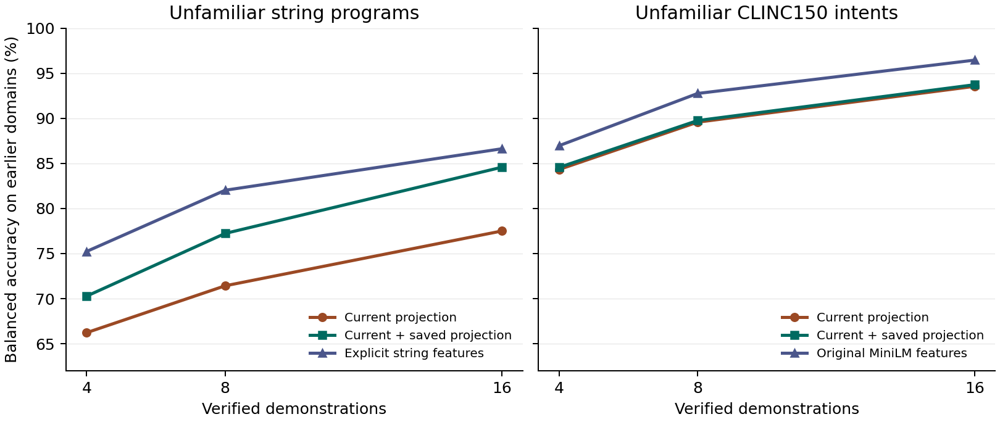

# Does selective weight retention help with unfamiliar human requests?

**Result, November 25, 2026.** The capability gain from the controlled string tasks largely disappeared on human-written requests. On previously unpracticed intents from the earlier domains, keeping an experience-selected projection improved over the current learned projection by **0.20 percentage points** (95% interval +0.03 to +0.40). The frozen pretrained representation with the same fresh ridge learner was **2.71 points better** than the routed model (+2.35 to +3.03). Providing the actual hidden practice boundary closed only a fraction of that gap.

| Input to a new task's readout | Earlier domains | Recent domains |
|---|---:|---:|
| Original pretrained MiniLM features, 384 dimensions | **92.05%** | **93.17%** |
| PCA, 64 dimensions, fitted on practice features alone | 91.24% | 91.61% |
| Random initial projection, 64 dimensions | 88.39% | 90.07% |
| Current learned projection, 64 dimensions | 89.14% | 89.62% |
| Routed archived and current projections | 89.34% | 89.76% |
| Pooled archived and current features | 89.42% | 89.87% |
| One consolidated projection, 64 dimensions | 89.25% | 89.67% |

The metric is balanced accuracy on a **binary, few-shot intent task**. For example, a reader sees labeled requests from an unfamiliar banking intent and other unfamiliar banking intents, then predicts new labels for separate official test utterances. It gets four, eight or sixteen demonstrations. The table averages the three budgets equally. The published 150-way and out-of-scope CLINC evaluations measure different tasks. In the earlier domains the original features scored 86.96%, 92.75% and 96.45% at the three budgets, versus 84.55%, 89.75% and 93.72% for the routed version. The original representation led the routed version within every domain when averaged over lifetimes in which it appeared in each role. [Program-level trial scores](intent-trials.npz) · [Domain and budget breakdown](summary.json)

**What explains the small gain?** In five of eight lifetimes the selector kept episode 230 of 240. We repeated each training history and supplied the precise boundary. On earlier-domain tests this raised the routed gain over current from 0.20 to **0.63 points** (+0.48 to +0.82). The boundary projection by itself was essentially tied with current there (−0.04 points, −0.42 to +0.35). The original geometry was already useful, and both the dimensional bottleneck and the practice objective can affect the result. PCA at the same 64 dimensions beat the learned route by 1.90 and 1.85 points, respectively. A post-hoc development-selected mixture of the original features with both learned kernels scored 92.15% and 93.16%, close to the original alone. All original trial scores reproduced exactly during this audit. [Timing and geometry diagnostic](timing-diagnostic.json)

**Feedback.** We used 128 simulated advisor histories per lifetime. Each method had the same eight fresh verified answers per advisor, and we compared queries on which the learners were jointly correct or jointly wrong before a true or false advice example. On earlier domains the routed learner reduced harmful flips by 0.28 points under stable reliability and 0.33 after reversal compared with current-only. Truthful repairs increased by an estimated 0.84 and 0.96 points, with both intervals spanning zero. All prespecified feedback bounds passed in both domain groups, for routing and consolidation. The capability target failed. Arm-specific eligible counts and paired estimates are retained. [Feedback counts and task assignments](settings.json) · [Intervals](summary.json)

**Limits.** The pretrained sentence encoder was frozen. Only the downstream projection and task readouts changed. These are static intent labels, and simulated independent label errors replace real human persuasion. Words supporting a familiar intent can already be close in MiniLM's representation even when its class identifier was withheld during this experiment. This result weighs against the claim that preserving a compressed specialist representation generally improves a capable pretrained model. It leaves open the case where the user's experience supplies a genuinely new distinction absent from the original geometry.

**Reproduction.** Public source files, model weights and embeddings stay outside Git in `~/.cache/alignment-research/clinc-minilm-v1`. The prepared corpus contained 22,495 in-scope utterances after dropping five normalized training duplicates. The little-endian float32 embedding table had SHA-256 `baa29a91f5588105d8b58e0617c1f9e2a243c064860dd70aa154520e36c19ffa` on the local ARM CPU. The preparation script verifies all four upstream file digests. Platform differences may affect the quantized encoder's numerical output. The local preparation took 64 seconds, each study run under 15 seconds, on one inference/training thread; the primary training process peaked below 0.60 GB resident. No paid compute was used.

```sh
cd dynamic-learning/intent-learning
uv run --no-project --python 3.12 --with onnxruntime==1.32.0 --with tokenizers==0.23.3 --with numpy==2.5.5 python prepare.py
python3 experiment_intents.py
python3 experiment_intents.py --diagnose
```

The [changing queue policy study](policy-change.md) uses these requests in a different experiment. It tests how learned relationships between changes affect the next weight update, what a learner decides to verify, and how verifier errors propagate.

A [new-class routing test](provisional.md) measured which requests to verify when real text classifiers make wording-dependent mistakes. A [MiniLM weight intervention](value-history.md) tests ordinary SGD inside the pretrained attention block.

## Protocol recorded before model training

CLINC150 contains human-written requests from 150 intents in ten domains. Test whether the string results survive authentic wording, realistic semantic features and tasks with overlapping intent descriptions. Use the official dataset at commit 828f8093932c8fe6ca7936c3d2e52903b1c523de and the arm64 quantized all-MiniLM-L6-v2 encoder at revision 1110a243fdf4706b3f48f1d95db1a4f5529b4d41. Cache only local copies. Prior exposure of the pretrained encoder to similar material is unknown. [Dataset paper](https://aclanthology.org/D19-1131/) · [Authors' repository](https://github.com/clinc/oos-eval) · [Encoder model card](https://huggingface.co/sentence-transformers/all-MiniLM-L6-v2)

Eight seeds (811–818). For each domain reserve eight intents for practice, three for choosing ridge and routing parameters, and four completely unpracticed intents for testing. Assign five domains to the earlier period and five to the recent period. Train for 240 episodes, switching unannounced after 50, 90, 150 or 190 episodes, twice each. Practice classifies verified requests using a trainable 384-to-64 projection on frozen pretrained features. Reuse the reservoir snapshot rule and offline similarity distillation from the string study. The archive selector sees verified examples from practice; only the practice loss sees named class indices. Fit a fresh binary task readout with 4, 8 and 16 verified examples. Each new task distinguishes an unpracticed intent from other unpracticed intents in its own domain. Fit from official training utterances for those held-out intents and score separate official test utterances. Validation uses different intent labels, with demonstrations from their training split and queries from their validation split. Balance positive and negative queries and average programs equally. Remove normalized duplicate strings before splitting intent roles.

Compare the current, archived, conservative evidence-routed, pooled and single distilled representations. Include the original 384-dimensional encoder, an untrained 64-dimensional projection, and PCA down to 64 dimensions fitted on practice features alone. Report per-domain, per-lifetime and per-budget scores. For the string architecture to transfer, the conservative lower bound for the routed learner's gain on the earlier domains must exceed three points versus current alone, with a lower bound above −2 on recent domains. Report differences versus the original pretrained encoder regardless of outcome. Check the distilled learner's distance from the pooled teacher and compare it to current alone.

On both routed and distilled learners, fork one reserved advice example with true and false labels, then score on distinct natural-language queries that both learners initially answered correctly or incorrectly. Compare with the same current-only readout under identical stable or reversed reliability, using 128 independently simulated advisor histories, eight fresh checks per source and the existing two-point noninferiority bounds for excess harm and loss of truthful repairs. This is a controlled feedback intervention on intent classification, with simulated advisors. It does not evaluate conversational honesty or the alignment of the pretrained encoder.

## Diagnostic fixed after the human-language result

Five of the eight histories saved at episode 230. To distinguish poor snapshot timing from limited transfer available at the true boundary, reconstruct all eight lifetimes and keep the projection immediately before the hidden switch. Compare its readout and its evidence-weighted combination with current weights using the same development and evaluation observations as in the primary test. Independently ask whether preserving the full pretrained features rescues the practical comparison: mix the original kernel with the mean of current and true-boundary projection kernels, choosing the fraction from 0, .1, .25, .5 and 1 plus the ridge penalty using development data alone. Include the same-input fitted PCA control. Verify that the main trial scores reproduce exactly before interpreting the diagnostic. This is a post-hoc sensitivity analysis on the same corpus and seeds.

## Residual learning protocol specified after the timing diagnostic

The correct save time recovered less than one point on human intents, and a trained 64-dimensional projection discarded useful information. Test a different account on 12 fresh histories (841–852): practice might improve future weight updates if it preserves the original 384-dimensional semantic features and explicitly trains for rapid learning of new tasks. Append a trainable 64-dimensional tanh feature branch. Both methods retain the original features. One learns ordinary practice-intent classification. The other differentiates query loss through a ridge readout fitted on eight support requests from the same practice episode. Use exactly the same labeled requests and number of optimizer steps for both objectives. Each episode contrasts one practice intent with the seven other practice intents in the same domain. Evaluation intents and official test strings stay excluded. Use two training steps per episode, 240 episodes, balanced switch times of 50, 90, 150 and 190.

At checkpoints 0, 60, 120 and 240, evaluate new earlier- and recent-domain intents. Select the positive residual fraction from 0, .1, .25 and .5 and the ridge penalty on held-out development intents. The fixed zero fraction reproduces the original encoder. At final evaluation compare the meta-trained residual with (a) original MiniLM, (b) supervised residual and (c) the same evaluation applied to an untrained randomly initialized residual. Report any gain already present at initialization. The existing three-point capability threshold still applies on earlier domains; a smaller positive lower bound can support a modest effect but cannot pass that target. Check current-family retention and the same jointly eligible correct/false advice outcomes versus the original encoder with equal verification. Record all checkpoints, zero-residual selections, and strongest results by sample budget. This follow-up uses the same real dataset with fresh intent partitions, so it is independent of earlier training seeds but is not a new corpus.

Across 12 fresh histories, training explicitly for rapid adaptation changed accuracy relative to the original encoder by +0.02 percentage points on earlier domains (paired interval −0.09 to +0.14) and −0.02 points on recent domains (−0.12 to +0.07). Both estimates are consistent with zero. Preserving the pretrained features addressed the earlier loss but yielded no measurable transfer gain at this scale. Reproduce with `python3 residual.py` from this directory. [Summary](residual-summary.json) · [Settings](residual-settings.json) · [Trials](residual-trials.npz)


