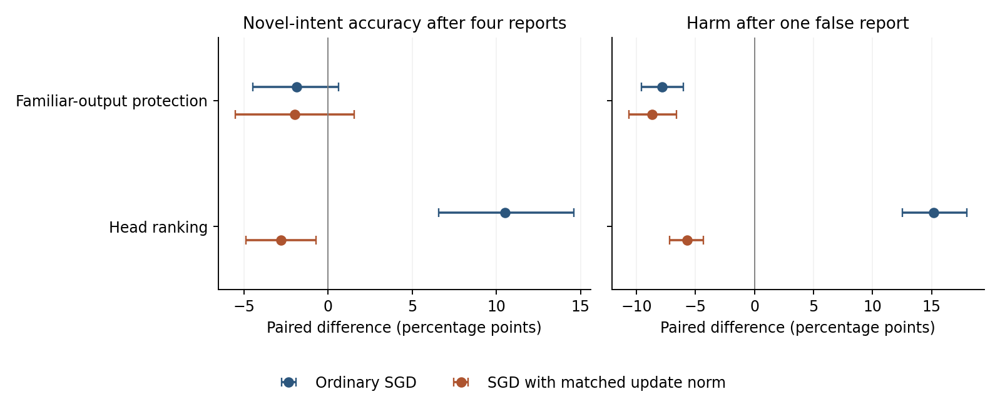

# Can experience change the next gradient step inside a pretrained text encoder?

On two intent corpora we changed the value weights inside MiniLM's last attention block and scored future requests with the updated encoder. On Banking77, remembering how twelve familiar examples depended on the weights reduced collateral errors at the same update norm. A classifier trained on frozen embeddings still reached much higher new-intent accuracy. [Banking77 comparison](#banking77-results)

## Protocol before fitting or evaluating

Use the full-precision, six-layer MiniLM sentence transformer. Give two copies different audit histories while preserving the same initial function on every sequence. In the last attention block, scale the value weights and bias of each head by a positive factor and divide the corresponding columns of the output projection by that same factor. Attention patterns, residuals, the subsequent feedforward block and all initial predictions are preserved in exact arithmetic. Now take ordinary binary cross-entropy SGD steps on only the final value matrix and its bias. With the output projection frozen, the effective step in original coordinates is multiplied by the inverse squared scale of that head. This is an explicit parameterization of a head-specific learning rate. Learning gradient transformations is prior art. The empirical questions are whether past reliable versus misleading corrections identify different useful heads, whether that transfers to unseen tasks in natural language, and whether any gain survives matching the size of the effective edit. [Pretrained model](https://huggingface.co/sentence-transformers/all-MiniLM-L6-v2) · [Meta-Curvature](https://proceedings.neurips.cc/paper/2019/hash/57c0531e13f40b91b3b0f1a30b529a1d-Abstract.html)

Use the five practice and five evaluation domains from the routing test with fresh seeds. For each assignment sample four intents. Construct a frozen binary readout from six official training embeddings of each of two familiar intents A (positive) and B (negative), using eight times the difference of their unit-normalized mean embeddings as the readout. Two further intents C and D have never been used to fit this readout. In a genuine redefinition, C is positive and D negative. In the alternate world those assignments are reversed. The meanings of A and B stay fixed. Supply a positive report on a C request the starting readout labels negative. Both worlds receive exactly that same first example and report. The next three observations are genuine, on D, C and D. Queries consist of eight distinct official test requests per intent. Use validation wording for all practice and tuning audits and training wording for support. Condition on an eligible opening and report any assignments skipped. Adapt only transformer value parameters. Keep the readout, all remaining weights and input tokens fixed.

Estimate per-head support-to-audit gradient inner products on eight practice assignments per domain. Both histories see the identical opening gradients and audit texts. Weight the genuine/alternate audit losses 80/20 in one history and 20/80 in the other. Rank heads by mean per-head inner product between support and audit gradients. Assign original-coordinate step multipliers 4, 1 and 0.25 to equal thirds in decreasing rank. Compare both histories, the original parameterization, a fixed random permutation of the change-heavy head multipliers, and ordinary SGD rescaled at each step to match the change-heavy effective parameter-delta norm on that control's gradient. Freeze assignments before tuning a single shared learning rate from 0.03, 0.1, 0.3 and 1 on four fresh practice assignments per domain, maximizing equally weighted correctness across both worlds, steps one/four and the original/change-heavy models. Evaluate twelve fresh assignments per held-out domain. Use one CPU thread.

Primary question is new-intent accuracy after the first true report. Require a three-point gain of change-heavy history over both ordinary and norm-matched SGD, with positive paired 95% lower bounds, and an upper bound below two points for excess flips on initially correct queries after the same report in the alternate world. Also compare both histories directly. Report familiar-intent retention, truth repairs, initial performance, sample budgets, both forks, head rankings, and per-domain effects. Use 2,048 paired episode resamples within each fixed domain. Verify the initial equality and the equivalence of at least one literal scaled-model SGD update to a head-scaled update in original coordinates. State when equivalence is guaranteed by construction. This experiment does not train a generative assistant or identify a universal learning-rate schedule.

## Head-ranking result

The change-heavy and exception-heavy histories selected the same four heads for the largest steps. Their one-report new-intent accuracies were identical (50.63%). Starting accuracy was 44.38% on these intents, partly because each opening was conditioned on a mistake. Change-heavy training gained 1.25 points over ordinary SGD after one report (−2.92 to +5.52) and increased harm in the alternate world by 15.20 points (+12.50 to +18.01). The joint target failed. With matched parameter-delta norms the new-intent advantage was zero (−0.73 to +0.73). The ranked direction reduced false-fork harm by 5.72 points versus that larger norm-matched update, but remained much more harmful than ordinary SGD.

The first report and all initial weights are identical across forks, while the correct labels on C and D reverse. Consequently each method’s two novel-intent accuracies after one report sum to exactly 100%. This identity was verified in the raw counts. The later verified observations make learning the right policy possible.

After four truthful examples, ranked updates reached 66.67% new-intent accuracy versus 56.15% for ordinary SGD. The norm-matched control reached 69.48%, 2.81 points ahead of the ranking (+0.73 to +4.90). These outcomes separate a larger step from learning a better direction. The shared tuning procedure selected the smallest tested rate, 0.03. In five literal attention rewrites initial logits differed by at most 0.00000024, and subsequent logits reproduced the effective head-scaled update to the saved precision. Twenty assignments were resampled during the entire run because no eligible opening occurred in the sixteen candidates. [Complete results](value-history.json) · [Episode counts and historical gradient alignments](value-history-trials.npz) · [Code](value_history.py)

Reproduce with Python 3.10, PyTorch, transformers 4.38.2, tokenizers, safetensors and NumPy (`python value_history.py`). The pinned full-precision MiniLM download is about 91 MB. The official encoder runs through the penultimate block once per accepted episode. The final block is recomputed for every affected support and query. The unused pooler is excluded in accordance with MiniLM's prescribed mean pooling.

## Follow-up protocol before testing protected directions

Can a transform learned from the model's *own familiar experiences* improve subsequent SGD while keeping its starting behavior fixed? On each assignment revisit the twelve familiar requests used to form the readout. Compute each old output logit's gradient with respect to the last-layer value weights and bias. Normalize each full gradient to unit length. Within each attention head take the two leading eigenvectors of the summed row covariance of those gradients. Before deployment rescale value and output parameters so ordinary SGD has effective multiplier 0.05 along those two directions and 1 elsewhere. This attenuates directions implicated in old predictions. The exact reparameterization uses the inverse square root on the values and the square root on the corresponding output columns. No rehearsal texts are needed for subsequent updates. This is a headwise approximation to protecting prior outputs. [Orthogonal Gradient Descent](https://proceedings.mlr.press/v108/farajtabar20a.html)

Use fresh seeds, four practice assignments per training domain for calibration and twelve assignments per held-out domain for evaluation. Include ordinary SGD, the headwise transform learned from the preceding unrelated assignment's own readout and history, a norm-matched ordinary update, and a stronger explicit gradient projection attenuating the span of the twelve full familiar gradients by the same factor. Supply independent old anchors and readout for the donor before the first assignment in each domain. Keep all support, audit and test data roles and both report forks from the preceding study. Calibrate each method independently for balanced overall accuracy across both worlds and budgets one/four on the wider grid 0, 0.001, 0.003, 0.01, 0.03, 0.1. Score untouched evaluation assignments using the frozen choices.

The primary metric is novel-intent accuracy after four observations on a genuine change. Require at least three points over both ordinary and norm-matched SGD, positive lower paired 95% bounds, at most two points of excess alternate-world harm after the first false report (upper bound), and at most two points lost on familiar intents after four true reports (lower bound). To attribute a gain specifically to this model's familiar experience require a positive lower bound over the donor history. Also report the exact full-gradient reference, both forks at both budgets, all learning rates and per-domain results. Verify a literal matrix rewrite and unmodified SGD against the effective projected update. Treat this as a controlled experiment on a pretrained encoder's adaptability. There is no claim that the brain performs this matrix operation.

As a mechanism check, compare the local transform and ordinary SGD at the local transform's calibrated rate, with the ordinary update scaled to exactly the same parameter distance on the identical opening gradient. Measure the RMS logit change on familiar held-out requests and the mean signed logit movement on the new classes under genuine labels. Also report the fraction of the opening-gradient energy removed, and the overlap of the local and unrelated two-dimensional head subspaces. Reconstruct the same evaluation assignments with the same random draws. These diagnostics concern a single edit before the worlds have become distinguishable.

## Familiar-history result

After four truthful reports the headwise transform reached 60.00% new-intent accuracy, versus 61.88% for ordinary SGD and 61.98% for the norm-matched step. Its difference from equally long updates was −1.98 points (−5.52 to +1.56). After the opening false report it broke 7.22% of previously correct predictions, compared with 15.91% for the equal-length update, a reduction of 8.70 points (6.63 to 10.66). Using the model's own familiar requests instead of a donor's reduced harm by 5.46 points (4.05 to 7.00). Their independently tuned rates differed. The same-history capability contrast was only +0.10 points (−2.29 to +2.29). The headwise mechanism protected behavior but missed its learning-speed criterion.

On the identical opening gradient, the headwise protection and its norm-matched control each moved the weights by 0.2025 in Euclidean norm on average. The RMS logit change on familiar held-out requests fell from 1.059 to 0.220. Mean signed progress on new-class logits also fell, from 0.166 to 0.120. This isolates a directional effect on what the update preserves, and shows its cost on new evidence.

The explicit full-gradient reference reached **81.15%** on new intents after four truthful reports, versus 61.88% for ordinarily tuned SGD. On familiar intents it retained 98.33% versus 98.23%. It broke 13.08% of initially correct predictions after the false first report versus 15.04% for ordinary SGD. Both the full and local methods preferred the upper edge of their rate grid. This comparison was a reference arm and prompted a separate corpus test specified below. [All arms, settings and intervals](protected-values.json) · [Paired raw outcomes and head-subspace examples](protected-value-trials.npz) · [Implementation](protect_values.py) · [Equal-norm diagnostic](value-diagnostic.json)

## Independent corpus test specified before reading Banking77 outcomes

Carry the full twelve-gradient update proxy to Banking77, a corpus of real single-domain customer requests spanning 77 intents. Use the authors' pinned official train/test files. Reserve test wording first and deduplicate normalized strings across splits. Randomly permute the 77 intent names with seed 390611, form 19 disjoint quartets, and leave the remaining name unused. Within each quartet fix A/B/C/D roles. Repeat six assignments with fresh exemplars and the same roles. No Banking77 example sets the optimizer or baseline hyperparameters. Require an opening C example rejected by the old head as before. Report resampling, initial accuracy and all task-level effects. Bootstrap the 19 quartets as paired clusters, retaining all six repeated episodes per quartet. [Original banking corpus paper](https://www.repository.cam.ac.uk/items/871fbc30-a009-4e4f-b4b1-2604ad5c2bed)

Keep the four-step tasks and false first report unchanged. Freeze the CLINC settings. For twelve prior gradients of a 384-by-385 value map including bias, the full basis occupies about 6.77 MiB in float32. Use full-gradient attenuation at learning rate 0.1, ordinary SGD at 0.03 and 0.1, and ordinary SGD scaled on its own current gradient to match the full projection's effective norm at 0.1. Compare projection onto the previous quartet's familiar-gradient span at 0.1. Use a separate preceding quartet for the first donor. Include two cheap comparators that learn a residual linear readout on the frozen transformer embeddings. Fit kernel ridge to signed target margins minus old logits, with either the support only or the support plus the twelve familiar examples constrained to zero logit change. Independently select ridge penalty from 0.01, 0.1, 1 and target magnitude from 1, 3, 8 on 20 fresh CLINC practice assignments by equally weighted correctness across both worlds and both budgets. Identical old anchors and support are available to all arms. The frozen readout is allowed to retain all observed examples for its solve.

To confirm a parameter-space benefit require at least three points on novel-intent accuracy after four truthful observations over both previously tuned ordinary and equal-norm SGD, with positive paired lower bounds. Require upper excess harm below two points after the false first report and lower familiar retention above minus two after four true reports against both. Require a positive lower bound over donor projection to attribute the benefit to access to the correct earlier experience. Separately require three points over both frozen readout controls and the same harm/retention bounds to claim that editing the transformer is practically advantageous. Any result outside these requirements remains a partial or negative result. Neither corpus supplies a real change of organizational policy or establishes assistant alignment.

Prior work already uses subspaces of earlier tasks to limit forgetting, including language-model fine-tuning. The comparison here asks a narrower question about the type of historical information that survives a fixed-rank intervention and its effects on truthful and misleading corrections. [Gradient Projection Memory](https://openreview.net/pdf?id=3AOj0RCNC2) · [Orthogonal Subspace Learning for Language Model Continual Learning](https://aclanthology.org/2023.findings-emnlp.715/)

## Which part of an old gradient matters?

Before viewing the external-corpus scores, specify a separate mechanism test. Each archived old request gives one gradient across all twelve value heads. Is the useful memory contained within individual heads or in how their changes combine? Let Q be the orthonormal basis of the twelve gradients. Compare its projection QQᵀ to SQQᵀS, where S flips the signs of six whole heads. This preserves rank, every eigenvalue, and every within-head block of the projection exactly. Cross-head blocks acquire a minus sign when only one of the two heads was flipped. The frozen pretrained model and its forward computation are identical before support arrives.

Use the same Banking77 task roles but three new draws of support and query wording per quartet, seed 780352. At each step use learning rate 0.1 and the same 95% attenuation. Average four balanced sign patterns fixed by seed 780351. Rescale each signed control's gradient to match the norm of the intact projector's update on that control's own current gradient. As an additional control delete all cross-head blocks, retain the within-head blocks exactly and match that update norm as well. The block-only control preserves the trace but generally changes the rank. Compare novel-task accuracy after four true reports, alternate-world harm after one false report, and familiar-task accuracy after four true reports. Bootstrap the 19 fixed quartets in pairs. Require a three-point genuine gain with positive lower bound over the sign control plus upper excess harm below two points before inferring that relative signs across heads buy useful adaptation. This intervention can test whether cross-head information in the optimizer's memory matters. It cannot establish that heads communicate during training or that an individual head represents a particular concept.

### Sampling amendment before external outcomes were available

The unbounded rejection sampler spent more than a minute on the seventh fixed quartet. Only completion counts had been printed. Cache original MiniLM embeddings for candidate and anchor training texts and use them to reject proposals whose minimum candidate logit is clearly positive. Any potential acceptance or numerical borderline still runs the full original forward check. Preserve the same random draws and ordered task roles. Cap each episode at 1,024 proposed assignments. If that cap is exhausted, report the quartet, omit it from the conditional complete-quartet estimate, and distinguish that estimate from a result on all 19. Never replace an omitted quartet with an easier one. Apply the same rule to the sign intervention.

## Banking77 results

Eighteen of nineteen disjoint quartets yielded all six eligible episodes, for 108 evaluated assignments. Quartet 15 reached the 1,024-proposal cap on its second repeat. Excluding its partial data gives a result conditional on the other eighteen quartets. Across the external assignment loops 1,670 proposals were rejected. Initial accuracy was 37.62% on the new intents in the genuine world because the opening C request had to be misclassified. The corpus supplied the text and intent labels, while the binary assignments, change timing and misleading report were constructed. The bank quartets and source deduplication counts are recorded in the results.

| Method with frozen CLINC settings | New intents after four truthful reports | Familiar intents after four truthful reports | Previously correct answers broken by the first false report |
|---|---:|---:|---:|
| Ordinary SGD, calibrated rate 0.03 | 53.41% | 98.21% | 12.91% |
| Ordinary SGD, rate 0.1 | 70.25% | 95.14% | 30.34% |
| Ordinary SGD, norm matched to full protection | 65.68% | 96.88% | 21.65% |
| Full protection from an unrelated task | 71.06% | 95.31% | 27.42% |
| Full protection from this task's twelve familiar examples | 71.76% | 98.09% | 12.91% |
| Residual readout on frozen MiniLM embeddings | 92.71% | 94.91% | 19.12% |
| Residual readout also constrained at twelve familiar examples | 94.21% | 95.14% | 19.77% |

At the same first-step norm, the protected transformer gained 6.08 points in genuine new-intent accuracy after four reports (paired quartet interval +2.95 to +9.03) and broke 8.73 points fewer initially correct answers after the false opening (−12.32 to −5.47). Comparing own history to a donor at the same learning rate gave 14.50 points less false harm (−20.17 to −9.31) and 2.78 points more retention on familiar intents (+0.93 to +4.92). Its novel-task accuracy advantage over the donor was just 0.69 points (−3.07 to +4.17). The correct earlier experience mattered most for protection.

Against calibrated ordinary SGD the genuine gain was 18.34 points (+13.31 to +23.55). The excess-harm estimate rounded to zero, but its upper bound was +2.12 points, above the specified +2.00. Compared with the stronger anchored readout the protected transformer lost 22.45 points of genuine new-intent accuracy (−28.33 to −16.72), preserved 2.95 points more familiar-intent accuracy (+1.45 to +4.75) and broke 6.85 points fewer initially correct predictions after the false report (−11.17 to −3.28). The joint confirmation and practical architecture criteria failed. These methods were calibrated for balanced accuracy, so the table does not establish the best classifier attainable at a fixed harm budget. [Full results and frozen baseline settings](bank-values.json) · [Counts per task and fork](bank-value-trials.npz) · [External-corpus evaluation](bank_values.py)

## Cross-head intervention result

Across 54 fresh episodes on eighteen banking quartets, the intact historical gradient basis achieved **73.26%** on new intents after four truthful reports. Flipping relative signs between heads while preserving all within-head projection blocks gave **65.94%** (paired difference +7.32 points, +3.76 to +10.94). False first-report harm was **11.40%** with the intact basis and **20.75%** under sign flips (−9.36 points, −12.23 to −6.44). Deleting cross-head blocks gave 66.90% on new intents and 20.74% harm. The equal-norm sign test passed its criterion. The same omitted quartet reached the cap before its first repeat. The result isolates cross-head information in the optimizer's record of familiar examples under this task construction. The forward model, projector rank, per-head diagonal blocks and conditional update norm were controlled. The frozen-readout result in the main external study still limits any practical architectural claim. [Sign experiment and intervals](head-signs.json) · [Counts for every mask](head-sign-trials.npz) · [Implementation](head_signs.py)

After running the initial experiment, run `python protect_values.py`, `python value_diagnostic.py`, `python bank_values.py` and `python head_signs.py` in the same environment. `python value_figure.py` redraws the CLINC figure.
