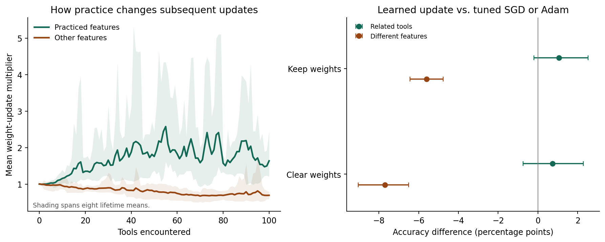

# Does practice change the next weight update?

[Follow-up on recognizing change](recognizing-change.md) tests whether a learner can revise earlier weight updates when its old habits fail. An exhaustive audit found that different feature triples can implement the same function in this tool generator. The follow-up reports results on genuinely unseen functions. The results below use the original triple-based splits.

**Result, November 24, 2026.** Practice changed how strongly a new observation moved the model's other predictions. Across eight fresh 100-tool lifetimes, the mean update multiplier rose from 1.00 to 1.63 on the six practiced features and fell from 1.00 to 0.69 on the other six. The benefit on related tasks fell short of the predefined three-point capability target. The cost on tasks using previously irrelevant features appeared in all eight follow-up lifetimes.



### What the model learned

Primary metric is accuracy on fresh inputs averaged equally after 1, 2, 4, and 8 demonstrations of an unfamiliar tool. The comparison below uses eight fresh lifetimes and 160 tools per family per lifetime. Both methods select rates on development tools. The conventional comparator selects between SGD and fresh Adam on development. Intervals resample whole lifetimes. They describe uncertainty inside this generator.

| After 100 practice tools | Learned update | Conventional | Paired difference, percentage points (95% interval) |
|---|---:|---:|---:|
| Related tools, carry previous adapter | 62.75% | 61.69% | +1.06 (−0.20 to +2.52) |
| Different features, carry previous adapter | 55.99% | 61.59% | −5.60 (−6.44 to −4.76) |
| Related tools, clear previous adapter | 64.99% | 64.25% | +0.74 (−0.75 to +2.28) |
| Different features, clear previous adapter | 56.68% | 64.37% | −7.69 (−9.04 to −6.51) |

Before practice, the learned rule and tuned uniform rule both scored 64.25% on related tools. After practice, retaining the preceding tool's solution reduced the learned rule's score to 62.75%. Clearing that solution recovered 2.24 points. A fixed rule told which six features recur reached 69.49% with the adapter cleared, and fell to 49.30% when the other six features mattered. The frozen kernel using examples in context scored 63.93% and 64.00% respectively. A family prior explains why practice can help or hurt even though both rule families are built from features the encoder already represents. The scalar rate search was finite, and the step sizes were selected for accuracy on related compositions.

The original eight lifetimes gave the experienced gate a fixed scalar rate. It gained 3.77 points over the identical adapter with its gate reset (95% interval +2.60 to +4.95) and lost 3.35 to the development-selected conventional optimizer. A mean gate from the other seven lifetimes scored 60.48% versus 60.34% for the model's own gate. On the related family 365 of 1,024 trials reached 75% accuracy at an observed budget for the experienced gate, versus 316 for the conventional control. Conditional on reaching it, the mean budgets were 5.47 and 5.83 examples. The accuracy averaged over all budgets is the primary endpoint. [First-run summaries](summary.json) · [Follow-up summaries](followup-summary.json)

### What happened to misleading feedback

In the follow-up, a tool execution established the correct result. The next training label either agreed or contradicted it. We tested a *different* input that shared all three relevant feature values. With the previous adapter retained on related tools, 916 paired probes were correct under both methods before the false label. The learned rule flipped **488/916** to wrong, versus **294/916** for the conventional control. The mean paired difference across lifetimes was +21.6 points (95% interval +14.3 to +31.1). Among 107 probes both initially got wrong, a truthful label repaired zero for the learned rule and two for the control. When the previous adapter was cleared, the harmful-flip difference fell to +7.2 points with an interval spanning zero (−1.4 to +15.4). On disjoint features the harmful-flip differences also spanned zero. The initial same-input experiment had just four jointly eligible repairs on related tools, which motivated this distinct-input follow-up. [All paired counts](followup-summary.json)

### Why the change propagates

The frozen transformer maps an input to a vector of 12 features. Its 12 adaptive output weights turn those features into an answer. If an update moves the weights by a vector of length one, the change in any other input's output logit is exactly the dot product of that vector with the other input's features. For a binary label, reversing the label reverses the direction of a normalized gradient step. The gate changes which other inputs that step influences, whether the label was correct or mistaken.

We reconstructed the follow-up checkpoints and tested every distinct input pair agreeing on a tool's three relevant features. Holding step length fixed, the learned update moved the second input's logit **0.22 units farther toward the supplied label** on related tools (95% interval +0.12 to +0.33) and **0.57 units less** on disjoint tools (−0.67 to −0.45). That post-hoc check identifies a directional effect independent of raw update size. Its predictions cover the direction of feedback propagation. The flip rates also depend on starting confidence and step length. [Mechanism results](geometry.json)

**Interpretation and limits.** The update rule learned which features usually deserve credit. The six-switch, binary-majority task contains the very regularity the learner exploited. Its transformer was pretrained on the complete 64-input feature table, independently of tool labels, and then frozen. The label channel omits source identity. The feedback experiment measures propagation of an incorrect training signal, and cannot establish that a language model became more agreeable or less aligned. The context control is a frozen kernel on the same features. A learned in-context transformer, a foundation-model-authored rule and a looped-block comparison were outside these runs. The publishable-scale question that remains is whether a learner can recognize a change in which features matter soon enough to recover future learning speed.

**Reproduce from the repository root.** The two training runs used one CPU thread each, took about seven seconds apiece on the local machine including startup, and peaked under 250 MB resident memory each. The encoder has 5,472 parameters. The fast adapter has 12 weights, the gate adds 12 persistent scalars, and Adam uses two 12-value moment vectors and a step count. The gated learner computes a coordinate-wise gradient product using the same verified labels as conventional practice. Rate tuning, peer gates and the privileged feature control are accounted for separately in the protocol.

```sh
python3 dynamic-learning/plasticity/pilot.py
python3 dynamic-learning/plasticity/analyse.py
python3 dynamic-learning/plasticity/followup.py
python3 dynamic-learning/plasticity/geometry.py
```

[First-run paired trials and checkpoints](trials.npz) · [First-run settings](run.json) · [Follow-up trials and 101 weight snapshots per lifetime](followup-trials.npz) · [Development-selected rates](followup-rates.json)

## Protocol recorded before the first model run

A small CPU feasibility study. The capability endpoint is forward transfer to new tool compositions. The feedback endpoint measures whether one misleading training label can overturn a verified answer. These binary tools make that test objectively scorable. It is a proxy for susceptibility to feedback.

**Model and experience.** Pretrain a tiny transformer to extract 12 known features from six binary switches (the switches and six adjacent pair products). Freeze it. A tool returns the majority vote of three signed features. During a lifetime the learner visits 100 tools sampled from 12 triples in a six-feature family. It carries a linear adapter from tool to tool. A diagonal gate scales its gradient updates. Train the gate from the agreement between a demonstration gradient and the gradient on fresh verified executions after that update. Hold out four other triples for tuning and four for the primary test. A second test draws only from the six other features. Random signs, inputs and tool order vary by lifetime. The experiment supplies a useful feature vocabulary and a recurring family structure.

**Fork test.** At 0, 1, 10 and 100 tools, freeze the adapter and gate separately. Reset the context. Fork the same adapter into experienced-gate, reset-gate, shuffled-gate, scalar SGD and Adam updates. Compare scalar rates and Adam rates chosen on development tools, including Adam with carried and cleared moments. Include independently practiced SGD and Adam trajectories, a frozen feature-kernel predictor using only demonstrations, a gate from other lifetimes, and a fixed gate given the prior knowledge of which six features recur. Check that same-checkpoint forks predict identically before learning and receive the identical first gradient. Evaluate at 0, 1, 2, 4 and 8 verified demonstrations, on inputs withheld from demonstrations. Save trial-level results and raw gate trajectories. Report all eight training/lifetime seeds, with seed as the replication unit.

**Predictions and decisions.** On new triples from the practiced family at checkpoint 100, I predict the experienced gate beats reset on mean accuracy over 1, 2, 4 and 8 demonstrations. The practical hurdle is three percentage points above the best development-selected conventional optimizer from the same checkpoint, with a paired seed-bootstrap 95% interval above zero. Report the 0-to-100 change in the paired advantage and the average first observed demonstration budget reaching 75% accuracy, counting failures separately. If a fixed family prior or a gate transferred from another lifetime matches the gain within one point, interpret it as learning a reusable family prior. If it reverses on the disjoint family, report that cost. Strong evidence for a better general-purpose learner would require replication on genuinely different tasks.

**Feedback intervention.** After eight demonstrations give every branch one more verified execution on a fresh input. Fork again into no feedback, truthful approval, and misleading approval of the opposite result on that input. Record harmful flips among initially correct answers and repairs among initially incorrect answers. Compare branches on the intersection of initially correct (or incorrect) trials to control for different competence. Preserve scores and counts if eligible subsets are small. The predicted trade-off is more harmful flips for the experienced gate than for the strongest conventional control. An effect in either direction is interpretable only alongside its response to truthful feedback.

**Budget.** One CPU thread, no downloads, no paid compute. Select rates only on development compositions. Model training, forks and outcome analysis run with the existing Python and PyTorch environment.

Also report ordinary gradient descent rescaled to match the length of the experienced gate's update on its own gradient at each step. This controls for a larger effective learning rate.

## Follow-up registered after the first pilot

The experienced gate beat reset on the practiced family by 3.77 points and lost to the development-selected conventional optimizer by 3.35. The gate also used a fixed scalar gain, while conventional optimizers had tuned rates. Only four trials jointly qualified for the truthful-repair comparison.

Use eight new seeds (141–148), an independently shuffled split of feature triples per seed, and new examples. At the 100-tool checkpoint cross two decisions at a known new-tool boundary: retain or clear the old adapter, and use a history-learned or uniform update direction. Tune the scalar rate of *every* rule on development, including gated SGD, from the same grid. Include the family-informed fixed gate, fresh Adam, and the frozen context predictor. Compare experienced vs tuned uniform at both boundaries. Measure the difference in learned-vs-uniform advantage between 0 and 100 tools. Prediction: clearing the old adapter raises early accuracy in the practiced family and tuning the gated rate closes part of the deficit. A three-point gain above the strongest practical comparator with a paired interval above zero is still the bar. Report transfer to the disjoint feature family and the stronger, privileged family-informed control separately.

For the feedback follow-up, take an additional verified input and then fork into a repeated true or opposite training label. Score the effect on a *different* input with identical values of all three relevant features and different nuisance features. Exclude support examples from both inputs. Score misleading new errors on jointly correct pre-feedback trials and truthful repairs on jointly wrong trials. Record how many qualify. This test measures feedback propagation through weights. The learner receives labels without source metadata. It cannot distinguish user approval from trusted execution by provenance. Strong claims about alignment would need a source-aware model and a language task.

## Mechanism check specified after the follow-up

The second run found a larger cost on the disjoint family than the benefit on familiar compositions. Use the recorded follow-up gates and reconstruct the frozen encoder from each seed. For every held-out triple and all distinct pairs of six-switch inputs that agree on those three features, take one unit-length step from the first input and measure the signed output-logit change at the second input. Compare the learned direction with the ordinary gradient direction. Prediction: practicing increases propagation between equivalent inputs in the practiced family and decreases propagation in the disjoint family. This is a post-hoc explanation of the follow-up, using the same seeds. It adds a controlled intervention and no independent replication.
