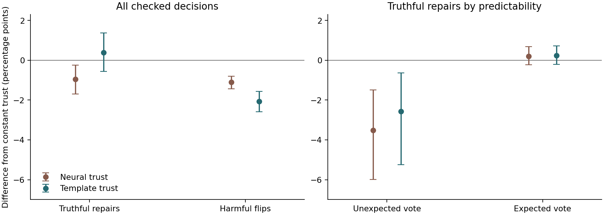

# Can a few recent decisions improve how weights learn the next one?

A small model absorbed reported ballots into its attention weights. On two forward-held-out Congresses, estimating a report’s credibility from previously observed voting patterns reduced harmful changes after false reports, while preserving average repairs after true reports. Genuine ballots the model found surprising received too little weight. The simple template model remained the most accurate predictor overall.

Two further studies tested whether a learner can choose useful checks and whether practicing with deliberately selected evidence improves its subsequent weight updates. [Protocols and results](active-verification.md)

A [longitudinal test](persistence.md) follows the same association across six separate motions and compares two ways to check a contradiction.



## Protocol recorded before loading vote outcomes

Test on real, temporally ordered group decisions where different members can agree or disagree depending on the motion. A new task is a previously unseen historical U.S. House roll call. Reveal a few member ballots, write them into a small model's weights, then predict other recorded ballots on that roll call. No pairing rules or target labels are invented. This is retrospective partial reconstruction; the random reveal order does not represent the order in which members actually voted. No party identities, text, member names, aggregate result, or fitted Voteview probabilities enter the models. Use direct yea and nay only (cast codes 1 and 6). [Voteview data and codebook](https://voteview.com/articles/data_help_votes)

Use the six transitions from Congress 110→111 through 115→116. At each transition choose 64 panel members by a seeded draw from those who actually cast yea or nay on at least 90% of the previous Congress's roll calls. Use the previous Congress alone to choose the panel. A motion is eligible when at least 24 of the 64 cast direct ballots; retirements, absences and other codes are missing. Split eligible previous motions chronologically 80/10/10 into historical training, development, and reserved old audits. In the next Congress expose only the first 32 eligible completed motions for adapting the slow weights. Test on the next 256 motions as the primary chronological block and the last 256 as a later check; ensure disjointness. Every scored motion has four fixed random reveal orders. Score the same remaining members after 1, 2, 4 or 8 examples. Give each motion and budget equal weight.

Train the conditional attention writer from the preceding study using member identity tokens, plus a separately trained equal-gate writer. Starting logits for all neural arms use each member's previous historical approval rate. Train slow weights over 192 minibatches of 24 previous motions. For the new Congress compare frozen historical weights, the same weights after 32 additional minibatches from the 32 recent complete motions, and matched additional training using 32 reserved *old* motions. Both adaptation arms have equal optimization and equal numbers of audited motions. Include a fresh model trained only on the 32 recent motions for the same update budget. Compare dynamic and fixed writes and clamp the dynamic model's gate only at evaluation. No task-level report history is provided at prediction beyond the written matrices.

Use strong low-cost controls. One predicts from historical member means. Another treats past motions as example vote vectors, weighting their similarity to the partial new vote. Fit its independent observation-error rate on old development motions and report old-only plus an equal mixture of old and 32 new templates. Missing template ballots use historical member rates. Include a shrinkage covariance predictor fitted to old motions with ridge and strength tuned on old development motions. For the practical three-point accuracy criterion compare with the strongest statistical baseline by old development Brier score (the template baseline also gets the 32 recent motions for the new-Congress comparison). Report every comparator. An old kernel that generalizes well is a negative result for the need to rewrite the learner. Quantify any effect of recent experience versus the matched extra old practice in both test periods and across each transition. Report differences in Brier score, held-out accuracy, and curves versus reports. Describe dispersion across the six partly related transitions; no inference of six independent populations.

Fork the fifth ballot after four genuine ballots into its real value and its opposite. Count truthful repairs among remaining ballots both learners initially missed and harm from the reversed ballot among those both initially predicted correctly. Compare the recent dynamic writer against its frozen copy and the recent fixed-gate writer on the same motions and wording-free inputs. The target retains the two-point bounds on excess harm and lost repairs. This is sensitivity to corrupted evidence; it is unrelated to judging a member's honesty. Keep raw public data in the cache, retain source digests, and save aggregate and per-motion metrics without names.

The first import encountered 36 duplicate direct records in the 115th House file. They all belonged to a presidential identifier. Voteview records presidential positions alongside House votes, and the vote-file chamber field alone did not exclude them. Before computing any six-transition results we required an identifier also to appear in Voteview's official House membership roster for that Congress. All remaining direct member/roll pairs must be unique. [Voteview member and vote files](https://voteview.com/data)

## Revisiting a disputed report, fixed before examining transition scores

Once an unverified fifth ballot is written into the attention matrix, can three later independently checked ballots reveal that the edit should be revised? Test on the early 256 motions in each of the same six held-out Congresses. Keep the original four reveal orders, target mask, and recent dynamic learner. The first four and last three visible votes are verified. The fifth is equally easy to flip in either direction in the intervention. In the assumed observation process its error rate is 10%, independent of the true ballot. The historical voting records themselves are unchanged.

Fork each motion into a truthful and an inverted fifth report, holding every other ballot and its wording-free member identifier fixed. Compare ordinary chronological writes, omitting the fifth ballot, replaying it with a constant 90% soft label, and replaying with an evidence-specific soft label. To get the latter, write the seven checked votes into a temporary matrix and estimate the fifth member's ballot probability. Combine those odds with the stated 9:1 source odds. Replay the chronological eight observations into a clean attention matrix, using the resulting probability as the fifth target. The deployable matrix can be used without evidence or a witness state at query time. Use both the neural reader itself and the statistical historical-template reader for this posterior. Also compute the direct probabilistic template prediction that integrates the noisy observation likelihood. All arms see the same eight inputs; replay and the extra pass cost additional compute.

Against the seven-vote omission arm, measure repairs of jointly eligible wrong target predictions after a truthful report, and harmful flips among initially correct predictions after its inversion. Compare posterior replay to constant soft-label replay to isolate the effect of selecting confidence from later evidence. Report the actual 90:10 mixture of accuracy and Brier as well as both conditional endpoints. Stratify by whether the true fifth vote was surprising to the neural reader given the other seven (probability below .2; usual votes above .8; report remaining middle group too). Give counts. Check whether rejecting implausible reports also reduces repairs from genuine unusual votes. A practical improvement requires a positive change in mixed-case accuracy, reduced harmful flips with the upper transition-resampling bound below zero, and truthful repairs with a lower bound above minus two points. Report effects per Congress and baseline quality. These results will share the original test motions and constitute a mechanism test, not a new population.

For the replay comparison also include a prospective check of trust using only the first four ballots. It uses the same odds formula and writes ballots in the same order. A gain over constant smoothing alone therefore cannot establish that the three later checks helped.

Two consolidation controls use the same neural odds as replay. Run the eight writes with each possible fifth label, then either average the two final probability predictions or write their posterior-weighted mean attention matrix. This separates revising the fifth gradient from combining completed counterfactual updates, and tests the cost of keeping only one matrix at prediction time.

## Chronological result

The historical-template control won the previous-session development comparison at every transition. In the next 256 unseen decisions after the 32 audits, it scored **86.91%** after adding the recent examples, versus **85.54%** for updating the neural writer and **85.86%** for the frozen historical writer. The template advantage over the recent neural writer held in all six Congresses. At one, two, four and eight ballots the recent neural learner scored 77.63%, 84.09%, 88.91%, and 91.54%; the template reached 78.59%, 85.26%, 90.64% and 93.17%. At the final 256 motions the template scored 87.75% and the recent writer 86.26%.

Recent weight updates beat the same extra optimization on 32 old motions by 2.58 points on the early blocks. But keeping the original weights beat recent optimization by 0.31 points. The matched extra-training contrast alone would therefore have made this treatment look better than its practical alternative. Clamping the learned gate changed early accuracy by only 0.04 points; training a fixed gate from the beginning scored 85.52%. The recent writer reduced harm from an inverted fifth ballot by 1.89 points relative to its frozen copy (descriptive transition resampling range −3.85 to −0.24) and lost 0.39 points of truthful repairs (−0.95 to +0.35). Against the recent fixed-gate model both differences were below 0.3 points. These historical partial reconstructions failed the practical capability target. The six chronological transitions overlap in their source sessions, and are not six independent replications. [Results by transition](results.json) · [Paired contrasts](summary.json) · [Per-motion scores](vote-trials.npz)

## Novelty audit specified after seeing the aggregate baseline advantage

A later House motion can repeat an earlier voting pattern. Audit whether the template advantage is confined to such repetitions. For each test motion, find the closest vector among the original training motions and the 32 recent audits, comparing only members who cast a direct ballot on both. Require at least 24 shared ballots for any comparison. Also compute a stricter novelty distance that treats an exactly reversed historical outcome as familiar. Flag exact matches, near matches (distance at most 5%), and distant motions (distance at least 15%). Additionally score the farthest quarter within each Congress and period, breaking distance ties by original roll order. Compare the recent neural writer, frozen writer, and recent template on identical hidden query ballots. Use full motion outcomes only to label these retrospective difficulty groups; the predictors and tuning have already been fixed. A novel voting configuration need not answer a novel policy question.

## Do real roll calls contain the sign reversal? Diagnostic fixed before inspecting four-member associations

A strong aggregate forecast leaves open whether the harder conditional direction task occurs naturally. Repeat the human-rating sign screen with four distinct House panel members. The two calibration members split their votes; compare the exact context yea/nay to nay/yea. In each context ask how the third member's yea versus nay changes the observed rate of yea for the fourth member. Both contexts contain one yea and one nay, and the target never participates in calibration. This is an observational association conditional on recorded participation.

For each previous Congress's training period sample 4,096 distinct ordered quadruples of incumbents on the original panel who also appear on the next House roster. Use a fixed seed and roster membership only for the incumbent filter, independent of new ballots. Require at least 16 previous training roll calls per context-by-trigger cell. Rank quadruples by their weaker proposed directional effect minus 1.64 standard errors. Keep up to 30 unique ordered trigger/target pairs. Rerank on the pooled old development and reserved rolls with at least five observations in every cell. Lock up to three candidates per transition (no filling in for uninformative or missing future outcomes). Confirm on eligible new motions after the initial 32 audits, requiring three points in each direction and both one-sided Fisher exact tests to survive Holm correction across *all* selected transitions and candidates. Adjacent legislative motions can be correlated. Also report the direction in each chronological half; claim temporal persistence only if both signs recur in each half. Treat nominal p-values as diagnostics rather than independent legislative replications. If a test cell is empty, the case fails. This exploratory selection uses the same public sessions as the reconstruction study, and tests a distinct hypothesis fixed after seeing the aggregate scores.

## Forward confirmation fixed before downloading Congresses 117 and 118

The six development transitions suggest a distinction between using the neural learner to judge an unusual report and using the empirical vote templates to judge it. Confirm the feedback result on two historically later target Congresses, 117 and 118. Use precisely the same panel, seeds, old training and tuning periods, 32 recent audits, 256 early test motions, four reveal orders and replay methods as above. The histories for fitting the two models are Congresses 116 and 117. No target-Congress outcome may change a setting. These periods are an additional test of the method selected after the first six; this is not an independent team replication.

Predict that template-informed replay will improve 90:10 mixed accuracy over constant soft replay and reduce harmful flips under a false report in both periods, with a pooled reduction of at least one percentage point and no more than two points lost in truthful repairs. Predict separately that neural self-replay will reduce truthful repairs among genuinely surprising votes in both periods. Report the sign even when the subgroup is small and also show prospective neural weighting and the direct template model. For uncertainty, resample contiguous, non-overlapping blocks of 16 motions within each Congress with replacement, keeping all four reveal orders together. Average the two session-level accuracy means. Pool eligible numerators and denominators before computing repair/harm differences. Require a positive lower accuracy bound, negative upper harm bound, and lower repair bound above −2 for a strong joint confirmation. Provide the aggregate intervals, each Congress separately, and the number of unique surprising motions. Distinguish ordinary one-step source smoothing from replay and statistical adjudication.

## Replay results in the first six sessions

With a 10% error rate for the disputed report, constant soft-label replay scored 91.29% mixed accuracy. The learner's own assessment using the later evidence scored 91.31%; assessing trust using only the first four votes already scored 91.39%. Thus the tiny overall self-replay gain versus a constant is insufficient evidence for the value of revisiting the report. Conditional harmful flips fell from 3.08% to 1.97% with self-replay, while truthful repairs fell from 7.54% to 6.60%. In the 243 surprising reveal orders out of 6,144, self-replay reduced truthful repairs from 6.42% to 3.76%. These are rates among eligible remaining ballots, and multiple orders can refer to the same motion.

Using the historical templates to assess the fifth report before rewriting the neural matrix gave 91.45% mixed accuracy, **1.21% harmful flips**, and **7.89% truthful repairs**. The harm improvement against constant was 1.87 points (descriptive range +1.53 to +2.17 in favor of template-assisted replay), and the repair difference was +0.35 (−0.10 to +1.17). On surprising true votes the repair rate was 5.47%. Averaging the two counterfactual matrices reached 91.33% mixed accuracy, close to averaging the two final predictions at 91.34%. The direct template calculation scored **93.02%**, ahead of each neural approach. Its feedback eligible sets use its own seven-vote baseline, so comparisons of its conditional flip rates with neural rates do not isolate the effect of the write rule. [Replay comparisons](replay-summary.json) · [Transition counts and strata](replay-trials.json)

## Repetition and the sign screen

Of 1,536 early test motions, **999 matched an earlier motion exactly on their jointly observed panel ballots** (at least 24 common members); 1,242 were within 5%. These are not duplicates of the legislative question or necessarily the full-chamber vote. On the farthest quarter of motions in each Congress, the recent writer scored 72.79%, the frozen writer 73.35%, and the recent template 74.68%. Only 55 motions were at least 15% distant from all available historical patterns. Scores there were 60.60%, 61.32%, and 61.45% respectively. The template retained a small edge on this subset, with much lower accuracy for every method. The directed and sign-invariant distances and the late-period comparisons are available for every motion. [Novelty audit](novelty.json)

For the direct sign-reversal screen, **zero of 18 locked candidate relationships** passed the future-Congress test. Three retained both nominated signs in both chronological halves, but the smallest Holm-adjusted p-value was 1.0. This screen concerns a particular four-member comparison with split calibration votes. It leaves open richer vote patterns. The direct result supports focusing on how strongly a correction should generalize before assuming this application needs frequent reversals of the sign. [Selected cases](sign-selection.json) · [Confirmation counts](sign-results.json)

## Reproduction

Use Python, NumPy, SciPy and CPU PyTorch. From this directory:

```sh
python3 learn.py && python3 analyse.py
python3 replay.py && python3 novelty.py
python3 signs.py --select && python3 signs.py
python3 confirmation.py && python3 figure.py
```

The loader obtains public CSV files from Voteview and verifies them against [recorded SHA-256 digests](sources.json). Local source files live under `~/.cache/alignment-research/house-votes`. The analysis reads only the House roster and direct ballot codes. The previous-session pipeline reproduced its aggregate results and per-motion arrays byte-for-byte on a second training run. Replay tests compare cold-loaded weights against the original eight-ballot predictions. [Recent neural checkpoints](recent-weights.npz) · [Voteview data dictionary and attribution](https://voteview.com/articles/data_help_votes)

After the forward comparison, one attribution control was still missing. The prospective neural reader isolates timing for neural trust estimates, whereas template-assisted replay needs its own prospective template control. Recompute confidence with the identical historical and recent templates after four ballots only, then perform the same eight neural writes. Compare this directly to the seven-ballot template estimate on both forward sessions. This timing audit uses the same outcomes and is post hoc.

## Forward result

The 117th and 118th Congresses contributed **512 previously untested motions**, each with four reveal orders. All three joint criteria for template-assisted replay versus constant trust passed. Under the 90:10 mixture of truthful and false reports, the accuracy gain was small (+0.15 points, 95% block interval +0.09 to +0.22). Conditional damage after a reversed report fell **2.07 points** (−2.59 to −1.57). Truthful repairs changed by **+0.39 points** (−0.56 to +1.37). Harm fell in both sessions, and mixed accuracy rose in both. Repair and harm denominators use the exact same seven-ballot neural checkpoint in these comparisons. The intervals resample blocks within these two sessions and do not quantify variation across all possible Congresses.

| Handling of the disputed ballot | Mixed accuracy | Truthful repairs | Harmful flips |
|---|---:|---:|---:|
| Constant 90% trust | 94.16% | 10.92% | 2.69% |
| Neural trust from the other seven ballots | 94.13% | 9.97% | 1.59% |
| Template trust from the first four ballots | 94.27% | 10.76% | 0.82% |
| Template trust from all seven other ballots | 94.32% | 11.32% | 0.63% |

The post-hoc timing comparison narrows the attribution. On the initial six sessions, adding the later three checks to the template trust estimate changed mixed accuracy by −0.02 points. On the forward sessions it gained +0.045 points (+0.019 to +0.077), increased truthful repairs by 0.55, and reduced harmful flips by a further 0.19. Most of the harm reduction was already available from the first four checks and the historical archive. Computing the direct template prediction yielded 95.78% mixed accuracy in the forward test, again ahead of the neural methods.

The trade-off on unexpected true votes also recurred. There were **34 surprising reveal orders on 30 distinct motions** (9 in Congress 117, 21 in Congress 118). Relative to the seven-ballot baseline, constant trust repaired 8.90% of eligible target errors after a genuine surprising ballot. Neural self-replay repaired **5.39%**, a loss of 3.51 points (−6.00 to −1.49); the loss was present in each Congress. Template-assisted replay repaired **6.32%**, a loss of 2.58 points (−5.25 to −0.64). These observations were genuine historical ballots that the neural reader gave less than 20% probability. The source corruption was simulated. Protecting aggregate response to true feedback left an identifiable exception for unusual truths. For group-level accuracy/Brier intervals, ten of 4,096 block resamples contained no surprising cases in one session; those draws were omitted for these two subgroup metrics. Pooled repair/harm denominators were available in all 4,096. [Forward results and intervals](confirmation.json) · [Per-motion sufficient statistics](confirmation-trials.npz) · [Forward comparison figure](forward-feedback.png)
