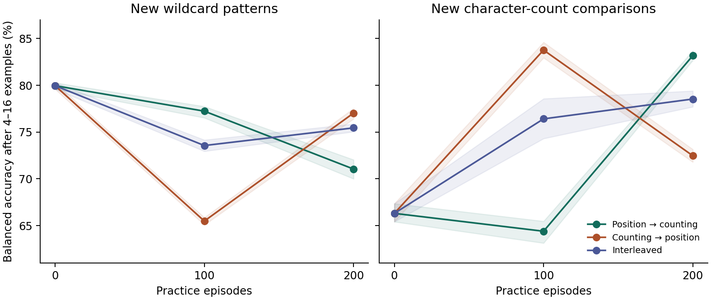

# Does transformer practice help learn a different string operation?

Subsequent studies [removed the practice-boundary signal](unannounced.md), [consolidated the archive back into one projection](consolidation.md), and [tested held-out intents on human-written requests](../intent-learning/README.md). The earlier-domain advantage over current weights fell from 5.64 points in the unannounced string experiment to 0.20 on the public language corpus.

**What changed.** Two identical transformers received identical input strings, labels and gradient steps. One finished with position lessons, the other with counting lessons. The second subsequently learned unfamiliar count comparisons **10.70 percentage points better** and unfamiliar wildcard programs **5.98 points worse**. Swapping 2,592 weights between the trained siblings moved most of the count effect with those weights. Keeping a copy of that layer from earlier in a *single* learner's life then recovered much of its earlier capacity to learn. The final joint test missed one performance bound.



## What the learner and the controls can see

The one-block transformer reads five characters. The shared encoder ends in a learned projection from 80 values to 32. We updated the encoder itself during practice. At each evaluation we discarded all task-specific output heads and fitted a fresh ridge readout to demonstrations of a new program. Accuracy is balanced across the two answers and averaged equally at 4, 8 and 16 demonstrations. Support and query strings are distinct. In each lifetime 512 strings are available for practice, 256 for development and 256 for evaluation. A seeded checksum partition keeps all two-position combinations present. The generator deliberately balances the demonstrations, including their positive and negative labels. These are small, executable classification tasks; the results do not measure natural language understanding.

The primary domain contains 160 wildcard patterns such as `a??b?` and 12 ordered comparisons such as `s.count("a") > s.count("b")`. The confirmation adds 160 exclusive-or programs and six count-equality tests. Each full truth table differs from all practice/development tables even after flipping the labels. A second audit restricted to each lifetime's evaluation pool found one pair of count tests with complementary labels in the initial pilot (seed 454). Weighting them as one changes the eight-lifetime adaptive-minus-baseline comparison by 0.035 points. The other three cohorts had no such collisions. Program quartiles and learning curves are in the summaries. Each cohort uses eight distinct seeds. Intervals are paired lifetime-bootstrap intervals, conditional on this generator.

## From a practice effect to a weight intervention

1. **Position-only practice failed to produce broad transfer.** On counting, training to predict from a support set reduced accuracy from 65.76% at initialization to 63.81%. Letting predictive evidence select between the practiced and initial representations reached 66.11%. Ridge on raw position indicators and explicit counts reached 79.66%. That comparison motivated separate practice histories. [Pilot outcomes](string-results.json) · [Paired comparisons](summary.json)
2. **Sequence alone changed what could be learned next.** After both practice blocks, the count-last model scored 83.2% on count comparisons and 71.0% on wildcards. The position-last sibling scored 72.5% and 77.0%. The paired count effect was +10.70 points (95% interval +9.96 to +11.55), with a wildcard cost of 5.98 (+5.17 to +6.77). Interleaving scored 78.5% and 75.4%. The handcrafted count-only control reached 87.2% on counts and the position-only control reached 84.1% on wildcards. Practice changed the induced representation, but the engineered features remain strong references here. [Order results](order-results.json) · [Actual encoder and head checkpoints](order-checkpoints.npz)
3. **Moving the final projection transferred much of the effect.** Installing the count-last sibling's projection in the position-last receiver improved count accuracy by **9.22 points** (+8.43 to +10.25) and cost **3.18** on wildcards. Transplanting just the attention/feed-forward block improved count accuracy by **2.33 points**. In the reverse direction, installing the position-last projection reduced count accuracy by 8.52 points. These matched comparisons hold the receiving readout's penalty fixed and give both copies identical fresh demonstrations. The swap identifies an effect of a parameter group in this shared initialization; its interaction with the rest of the encoder is included. A full rerun reproduced the original weights, trial scores and feedback summaries exactly. [Matched swap results](summary.json) · [Per-program trials](order-trials.npz)
4. **One past projection helped a single learner recover.** Eight further, counterbalanced lifetimes kept the first phase's projection and the rest of the final encoder. For each new tool, the learner fitted one readout through each projection and weighted their predictions by log loss on earlier demonstrations. By 16 examples it gave the older projection 83% weight on new programs of the earlier family and 16% on the later family. With the same examples, borrowing another program's weights for this decision cost 2.11 and 2.54 points respectively. Relative to always using the final projection, the adaptive model gained **7.90 points** (+6.22 to +9.62) on the earlier family and lost **1.63** (−1.84 to −1.40) on the later family. Simply pooling both feature kernels recovered 7.61 points on the earlier family. The extra operations exposed a limit: the adaptive learner reached 58.8% on exclusive-or and 52.9% on count equality, with intervals spanning zero for its advantage over using only the final projection. The saved projection costs 2,592 additional parameters; adaptive inference evaluates both projections and fits two readouts. [Recovery results](recovery-summary.json)

## Joint confirmation on the same learner

On the final eight fresh lifetimes, the adaptive learner and the current-only control saw identical, balanced demonstrations. Both estimated the reliability of each advisor from eight fresh independently verified answers per advisor, in addition to historical checks. We forked each possible advice label and tested its effect on distinct strings. Harmful-flip rates use the queries that *both* learners initially answered correctly. Repair rates use those both initially answered incorrectly. Feedback sources in this simulation have symmetric error rates independent of the specific question. The implementation executes stored rule truth tables when checking the simulated advisors. In the exploratory first cohort the checks were simulated directly as Bernoulli correctness indicators.

| Fresh comparison | Adaptive | Current only | Paired accuracy difference, points (95% interval) |
|---|---:|---:|---:|
| New programs from the first practice family | 79.67% | 71.92% | +7.75 (+5.86 to +9.61) |
| New programs from the last practice family | 77.80% | 79.66% | −1.86 (−2.46 to −1.33) |

On the first family, adaptive minus current-only harmful flips were **−1.08 points** with stable sources and **−1.37** after reversal. Truthful repairs changed by **+1.49** and **+1.52** respectively. On the last family those differences were −0.01 and −0.02 for harm, and −0.29 and −0.30 for repair. All eight feedback comparisons passed their two-point noninferiority bounds. The retention interval on the last family crossed the two-point loss limit, so **joint success was not established**. The adaptive learner's advantages over pooling were 0.30 and 0.27 points, both intervals spanning zero; explicit features beat it by 2.38 and 2.75 points. [Joint results with eligibility and intervals](joint-summary.json) · [Joint trials](joint-trials.npz)

Verification also has a measurable cost. In the order experiment, eight new checks **per source** reduced harmful flips on count comparisons by 2.24 points and improved truthful repairs by 2.10 after a reversal, compared to keeping only historical trust. The same estimator increased harmful flips by 0.30 points under stable reliability. On the final two-projection learner, fresh checks reduced post-reversal harm by 1.69 and 1.83 points on the earlier and later family respectively. These source-dependent effects concern the propagation of incorrect labels into readout weights. Extrapolation to an assistant's judgments or motives would need direct evidence. [Feedback curves at 0, 2, 8 and 32 checks](summary.json)

**Research judgment.** The strongest finding is the causal connection between practice order, an identifiable group of weights, and later sample efficiency. Preserving an older representation works, but most of the recovery is available to an ordinary pooled readout. A stronger architectural claim needs a clear advantage over that control, evidence on a wider stream than two announced training phases, and a way to decide which weights to save when the boundary is unknown.

**Reproduction.** Each training run used a single CPU thread with no downloads or paid compute. Measured process peaks for these experiments were below 0.66 GB. Python, NumPy and PyTorch are required. The original protocols and predictions follow the commands.

```sh
cd dynamic-learning/string-learning
python3 experiment.py
python3 order.py
python3 analyse.py
python3 recovery.py
python3 joint.py
```

[Initial trials](string-trials.npz) · [Recovery settings](recovery-settings.json) · [Recovery trials](recovery-trials.npz) · [Final settings](joint-settings.json)

## Protocol specified before fitting

Use all 1,024 five-character strings over four symbols. Split strings into disjoint practice, development and evaluation pools per lifetime. Practice identifies symbols at individual positions. Development uses two-position alternatives (either position matches). Test two new operation families: shell-style wildcard patterns requiring *both* positions to match, and Python character-count comparisons. Neither test operation is used to learn the representation or tune parameters. Compare every program's complete truth table with practice and development, in both label orientations, and deduplicate test functions within family.

Across eight fresh seeds, allow the transformer representation itself to change. Compare two practice objectives on identical labeled examples, with equal gradient-step counts: ordinary supervised training with a separate head per practiced task, and training the representation to predict query labels after seeing a small labeled support set. Save the initial representation and checkpoints after 10 and 100 practice episodes. At a new task give each representation the same ridge readout, tuned only on development. The raw-feature control uses position indicators and character counts. Combine the post-practice and initial representations' predictions using their accuracy on past demonstrations, comparing to a development-tuned constant combination. Supply balanced positive and negative demonstrations and evaluate balanced accuracy on other strings. Report mean accuracy at 4, 8 and 16 demonstrations. A practical capability win requires three points over the strongest development-selected conventional baseline with a paired interval above zero on count comparisons. Report both operation families, raw-feature results separately, curves at all budgets and variation across programs. This is a test for forward transfer, not a claim that the operations themselves are new mathematical problems.

For feedback, use the same task learner and score the effect of one new, possibly incorrect label on new query strings. Give each of two advisors a random identity, simulated historical reliability .90 or .55, and 40 historical checks per advisor. In different futures those rates stay fixed or swap. At 0, 2, 8 and 32 fresh verified answers per source, compare the frozen historical estimate, a recent-evidence estimate, a pooled source-blind estimate, and a no-advice copy. Use independent calibration and advice examples. Report how often advice changes an initially correct query answer to wrong and repairs an initially wrong answer. Weight per-source true and false forks by declared source frequencies in each future. A useful recovery after reversal requires at least two points fewer harmful flips than frozen trust with at most two points fewer truthful repairs, and report the corresponding costs in the stable future. All uncertainty intervals resample paired lifetimes. No cloud compute.

## Follow-up protocol recorded after the first results

Position-only episodic practice reduced count-task accuracy from 65.76% to 63.81%. An input representation with explicit counts scored 79.66%. Now isolate *order of experience* using eight new lifetimes (501–508). Practice 100 position episodes and 100 count-threshold episodes. Give three clones the same initialization and exactly the same labeled examples and optimizer budget in three orders: positions then counts, counts then positions, and interleaved. Train the entire encoder using ordinary supervised task heads. Test parameter snapshots halfway and at the end, after throwing away all practice heads. Fit a fresh ridge readout from 4, 8 or 16 demonstrations. Test rules remain distinct on the full 1,024-string domain, including their label inverses. Count thresholds used in practice are related primitives; comparing the counts of two different symbols is a held-out operation.

I predict that finishing with count lessons will help count comparisons and impair wildcard learning relative to finishing with position lessons. Interleaving should reduce the difference between families. As an intervention, transplant the final transformer attention/MLP block and then the output projection between the two blocked-order siblings, with other receiver parameters held fixed. An effect identifies dependence on the transplanted weights in this shared initialization; co-adaptation can make a swap fail. Also measure an order-insensitive character-count readout and raw position-only features with the same ridge procedure. Tune regularization across both development families (position OR and exact single-symbol counts). Split selection is balanced by family. Report initial, intermediate, final, and transplanted accuracy, plus uncertainty on the within-seed order effects. Three points of advantage across both held-out families over the development-selected comparison remains a practical hurdle.

For the feedback check, use the interleaved model and verify the simulator by executing rules on independent calibration strings. Use 128 independent advisor histories per seed with .90/.55 reliability and either stable or swapped reliability after the boundary. Compare frozen trust, the recent-eight estimator, source-blind updating and an exponentially discounted estimator (eight-check half-life). Measure harmful/repair rates after 0, 2, 8 and 32 verified answers per source. Use verified inputs disjoint from the evaluation pool. Use a predeclared 0.05 grid for advice update strength so all policies have the same resolution. Prediction: fresh verification improves both kinds of response after reversal but the eight-check estimator may suffer excess variance in a stable environment. Report paid verification cost separately from capability demonstrations.

## Single-history recovery check specified after the order experiment

Test whether the order effect can be reduced without storing a second full encoder. Use eight new seeds (551–558). For each seed train one blocked history, counterbalancing the last curriculum by seed. Save the output projection after the first phase. At the final checkpoint compare the current encoder to the same encoder using the saved first-phase projection. Both heads learn the new task only from its current demonstrations. Include the selected final projection, initial encoder, raw position/count features, a static mixture of the two readouts, a single ridge readout on the average of the two kernels, adaptive mixing from previous verified predictions, and borrowed routing evidence from another task. Report forced swaps at the final learner's fixed ridge penalty. Give each practical method its own penalty selected on both development families. The matched intervention addresses the independently tuned penalties in the initial transplant analysis.

Prediction: using the saved projection alongside the current one will improve the average over a history's *first* family's unfamiliar test programs by three points with an interval above zero. Check losses separately for the last family; tolerate at most two points. Compare to the pooled-kernel readout to test whether state-dependent routing earned its cost. Also report two further operations untouched by tuning: exactly one of two positional matches, and equality of two symbol counts. Equality can require a nonlinear representation. Retain program-level data, normalize label orientation in the truth-table audit, and publish any failures. The test of source drift remains separate from this mechanism experiment.

## Joint confirmation specified after the single-history recovery check

The adaptive two-projection learner recovered 7.90 points on new programs from the first family and lost 1.63 on the last family. On eight additional counterbalanced lifetimes (601–608), apply the capability and feedback tests to the *same deployed learner*. Freeze the two-projection scheme, development selection, and feedback rule. Compare against the current-only model given identical fresh verification; also compare recent versus frozen and source-blind trust within the two-projection model. Use 128 advisor histories, eight fresh checks per advisor, stable and reversed futures, the same true/false advice, and distinct query strings. Count harmful flips only on queries both compared models initially got right, repairs only where both were initially wrong. Weight false and truthful forks by the declared environments. For the two-projection learner retain the verified mixing coefficient during unverified advice.

Joint success requires a lower paired 95% bound above +3 points on earlier-family capability, a lower bound above −2 on last-family capability, upper bounds below +2 for excess harmful flips, and lower bounds above −2 for truthful repair differences relative to the equally verified current-only model. Check both families in both source environments. Report all contrasts and identify any failure, plus how the two-projection learner compares to the explicit-feature reference. Intervals quantify seed variability within this generator.
