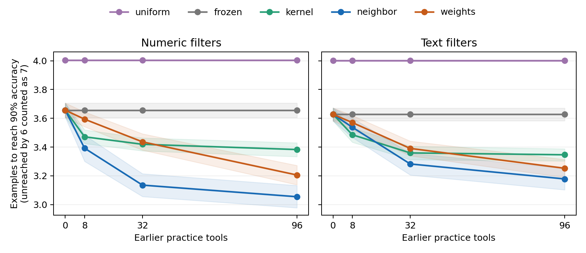

# Can practice make an unfamiliar tool cheaper to learn?

## Registration before development and test

Use Google's public two-layer, 128-hidden BERT masked language model, pinned at revision `30b0a37ccaaa32f332884b96992754e246e48c5f`. A local runner caches the exact last hidden representation at the mask, after the MLM transform. Its pretrained output scores for red, blue, green and gold rank four possible fields in a record. New tool descriptions contain names from four semantic groups. Each independent lifetime assigns groups to fields by a random permutation. The group name, permutation and true field are hidden from all learners. Later tools use new names, prompts and executable predicates. This deliberately creates a transferable naming convention and an independently unknown per-tool operation. The learner must predict binary outputs on fresh records. A supplied interpreter can execute 16 candidate programs (four fields times four possible predicates). Count the work done by that interpreter separately from the neural encoder.

Compare frozen weights, cosine nearest-neighbor retrieval of saved experience, and online gradient updates to the four existing output rows and biases in a private, output-only copy of the pretrained decoder. All start from identical model scores. For comparison with richer memory also run a cosine kernel over the entire archive. Include a uniform-prior hand-written active learner. Practice uses an independent uniform-prior teacher, exactly the same probes for each mechanism, and a budget of six actions. It can save a verified episode once at least two receipts concentrate at least 85% probability on one field, or save at the last action if that confidence has been reached. Only executed input/output examples determine the saved label. Charge the save, encode, query, update and storage costs. Practice checkpoints are 0, 8, 32 and 96 tools. The final targets do not write into the practice memory.

On each new tool an ordinary prediction begins by considering the two most probable fields and four predicates each. The learner may reason longer by expanding to the full sixteen programs, run an example selected for disagreement, or stop. Saving experience during practice competes with running another example. Use budgets of 1, 3 and 6 discretionary actions per new tool. Always include cheap fixed controls with a hand-written information-gathering rule. At each checkpoint also replay a common sequence of six uniformly initialized active-teacher probes to *every* mechanism, using full enumeration for scoring. This isolates learning from identical observations. Separately replay the selected policy's actual high-budget test probes to the competing mechanisms and score with full enumeration. Report the full example-by-example curve. The primary endpoint is the first of 0–6 verified examples reaching 90% accuracy on 96 separate records, scored 7 for failures. Report reach rate as well as the censored mean. Count a solved task at a given budget when it gets 90% or more. Report clean-to-corrupt losses on paired tasks after flipping the first probe response unbeknownst to the learner, and stale-memory damage after silently swapping the meanings of two groups since practice. Give the evaluators the same ground truth across arms within each condition.

Use 16 independent development lifetimes and 96 independent fresh lifetimes **per final domain**, eight target tools per lifetime balanced across semantic groups. Reuse target sets within a lifetime at each checkpoint. Disjoint support and verification records and disjoint operation truth tables between practice, development, numeric confirmation and text replication. Check these mechanically. Numeric confirmation applies a bit-count transformation; the text replication tests relations between characters. Use separate test seed ranges and disjoint final names for replication. Lifetime is the resampling unit. Report paired 95% bootstrap intervals (4,000 resamples). Ninety-six lifetimes give an interval half-width of roughly 0.20 examples for a paired lifetime SD of one. If the observed interval is too wide to rule out the practical effect, classify that contrast as inconclusive.

Use the existing Codex research harness to register up to two local proposals over bounded values for learning rate, retrieval temperature or mixing, and the thresholds for expansion and stopping. Keep all candidates, select settings separately for each mechanism on development using the average of normalized common-replay example count and unsolved fraction across the three budgets at 96 practice tools. Freeze settings, the strongest conventional baseline (frozen, uniform, neighbor or kernel), the best writable method, and the overall winner before final evaluation. If a conventional method wins, treat that as the primary architectural finding and still test the weight-update claim. Ablate the selected mechanism's entire persistent state at the same settings and use shuffled saved targets to test whether the content matters. Do not reselect the winner on confirmation or replication.

Prediction: after 96 tasks the selected writable model will need at least 0.5 fewer verified examples on numeric common replay than its own zero-history state, and at least 0.25 fewer than the strongest frozen/retrieval control. Require a paired interval above zero for each, replication in the same direction with intervals above zero, and no more than a five-point excess fall in solved tasks under misleading feedback versus the control (upper paired 95% bound at six actions). Compare the benefit from the selected winner's history against reset and shuffled history in each domain. Distinguish evidence of useful experience from evidence specifically for neural weight changes. Report process time, interpreter work, model calls, persisted bytes, and metered energy only if isolated/repeatable. Local execution only, no paid services. The model's pretraining energy is unknown. Freeze before opening either final seed range.

## Results

**Retrieving one saved example made unfamiliar tasks cheaper to teach.** After 96 earlier tools, nearest-neighbor retrieval needed 0.60 fewer new examples on numeric filters (paired 95% interval 0.52–0.68) and 0.45 fewer on text filters (0.38–0.53). The weight updates also helped on both families. The extra advantage we predicted for weight updates over retrieval failed on both. A uniform active learner caught up with enough clean executions.



Mean new examples to first reach 90% accuracy on 96 independently held-out records per tool. Each column uses the same six available teaching examples for every mechanism within a task. There are 768 target tools per domain, eight in each of 96 independent lifetimes. Tests reuse targets between checkpoints. Intervals refer to new lifetimes under this generator.

| Learner and test family | 0 prior tools | 8 | 32 | 96 |
|---|---:|---:|---:|---:|
| Frozen BERT, numeric | 3.66 | 3.66 | 3.66 | 3.66 |
| Retrieve one episode, numeric | 3.66 | 3.39 | 3.14 | **3.05** |
| Update four output rows, numeric | 3.66 | 3.59 | 3.44 | 3.21 |
| Pool the archive, numeric | 3.66 | 3.47 | 3.42 | 3.38 |
| Frozen BERT, text | 3.63 | 3.63 | 3.63 | 3.63 |
| Retrieve one episode, text | 3.63 | 3.54 | 3.28 | **3.18** |
| Update four output rows, text | 3.63 | 3.57 | 3.39 | 3.25 |
| Pool the archive, text | 3.63 | 3.49 | 3.36 | 3.35 |

The weight learner saved 0.45 numeric examples against its own starting point (0.40–0.51). Its point estimate missed the 0.50 target, although the interval includes 0.50. It **needed 0.15 more** than retrieval (0.09–0.21), ruling out the registered 0.25-example advantage here. On text it saved 0.38 against its own start (0.33–0.43) and needed 0.074 more than retrieval (0.008–0.141). Resetting the retrieval store erased its improvement on both families. Shuffling saved field labels while keeping embeddings and store size fixed cost it 0.65 numeric and 0.60 text examples (intervals 0.55–0.75 and 0.51–0.69). The content of past episodes mattered.

### Where the ordering changes

Counts of clean tasks solved out of 768 at each inference budget after 96 practice tools. One action buys either a verified input/output example or expansion from eight to sixteen candidate programs. The hand-written uniform policy can solve these finite tasks with enough reliable checks.

| Policy | Numeric, 1 / 3 / 6 actions | Text, 1 / 3 / 6 actions |
|---|---:|---:|
| Uniform prior, active checks | 0 / 0 / 768 | 0 / 0 / 768 |
| Frozen BERT | 6 / 41 / 739 | 0 / 103 / 746 |
| Retrieve one episode | 111 / 292 / 723 | 0 / 523 / 719 |
| Update four rows | 40 / 179 / 746 | 0 / 357 / 741 |
| Pool the archive | 0 / 60 / 768 | 0 / 150 / 768 |

Identical-evidence controls answer two different questions. On the common teacher sequence, retrieval reached the target sooner. On the exact clean receipts the retrieval policy chose for itself at six actions, all arms were allowed to consider all sixteen programs. Here the weight learner solved **1.95 percentage points more** numeric tasks than retrieval (0.78–3.26) and **2.47 points more** text tasks (0.65–4.30). Clearing retrieval memory at that final readout changed solved rate by less than two points in either domain, with both intervals crossing zero. Early guidance and the final interpretation of a long evidence sequence favor different policies.

When the first execution result was wrong, six-action numerical solved rates fell from 94.1% to 35.7% for retrieval and from 97.1% to 19.7% for weight updates. The latter lost **19.0 points more** (14.6–23.3), failing the five-point safety margin. Text excess damage was 4.9 points (0.7–9.5), which also failed to establish the margin. A silent change in two of four field assignments reduced retrieval's six-action solve rate by 2.9 points on numbers and 4.4 on text. The corresponding losses for weight updates were 4.3 and 9.2 points. Each comparison uses the same underlying records and controls the corrupted observation or changed convention. The first wrong answer was deliberately chosen as a stress test; it does not estimate the frequency of unreliable tools.

### Costs and what the experiment measures

At 96 practice tools the common practice policy purchased an average **355–357 executions**, saved about 96 episodes, and evaluated roughly 97,000 candidate-program outputs for probe selection and receipt processing. A fresh neural invocation per description would entail 96 practice encodings (864 input tokens) and one encoding per target. The main sweep reused the exact mask representation of each identical description. The uniform baseline needs no encoder or practice. A separate calibration performed uncached single-threaded BERT inference. Generating records, choosing examples, encoding 96 descriptions and building both memories together took 87 ms of process CPU on that run. Raw learner-state payloads after practice were about **101 KB** for retrieval and **4,128 bytes** for the writable model. Both exclude the common model, Python objects and allocator overhead. The weight baseline stores four 128-dimensional float64 update rows and four bias changes. Transplanting those changes into a private output copy inside pretrained BERT reproduced the scored logits within 0.000007 across all numeric prompts.

On numeric targets, retrieval consumed an average 0.9 / 2.1 / 4.2 verified examples and 128 / 387 / 966 candidate-program evaluations to select and process them at the three budgets. Weight updates consumed 0.5 / 2.1 / 4.5 examples and 61 / 472 / 1,126 such evaluations. The records and program outputs are precomputed for paired evaluation. These counts describe work requested by the policy. Actual CPU timings also include evaluator work. In four local power blocks, full BERT plus the six-action evaluation took 1.03–1.22 ms CPU per target for retrieval and 0.87–1.01 ms for the weight learner. Idle-subtracted power estimates changed sign between blocks for both. The measurements do not resolve energy per additional solved task. [Local timing, power samples and transplant check](results/machine.json)

### Interpretation and limitations

I would scale the **episodic retrieval plus active checking** baseline to a task with a larger program space, costly probes and more varied human-written tool descriptions. The weight mechanism remains interesting under a strict memory limit or with more verified observations. The two memory formats had different storage footprints. The follow-up below tests a retrieval control with the same 4,128-byte payload.

The model was Google's 4.42M-parameter two-layer BERT. Its output set the prior over which field a tool used. The experiment supplied the executable program library, probe chooser and Bayesian update. A tool's predicate was new and the descriptions were held out, but the same four fields, semantic groups and selection procedure recurred. Success here measures transfer of a naming convention, which is one component of learning a new tool. The result does not establish acquisition of arbitrary algorithms, lifelong improvement at open-ended reasoning, or frontier energy scaling. The 96 practice tools were paid for once. If practice exists solely to help subsequent numeric tasks, a rough observation-only break-even against zero-history retrieval would take roughly 590 further tasks at the observed benefit. That estimate assumes the convention persists and both kinds of observations have equal cost.

A post-run overlap audit found that one of the four text predicates becomes equivalent to a practice predicate if its output bit is flipped. All literal truth tables were distinct as registered. Excluding the 196 affected text tasks left a 0.42-example gain from retrieval over its initial state (0.33–0.50). Its remaining 0.038-example lead over weight updates was inconclusive (−0.041 to 0.121). Numeric confirmation had no such overlap. The replicated finding is that past episodes reduce teaching cost. Evidence for a general advantage of retrieval over weight changes is narrower. [Independent rescore and overlap analysis](results/audit.json)

### Reproduction and raw outputs

Registration is commit `bc51381`. Commit `2c976de` froze the model features, policies and scorer before opening either final seed range. Local Codex with Qwen2.5-Coder-7B through Ollama proposed one valid alternative. Development selected its higher learning rate for the weight learner and the default settings for retrieval. A second response contained an invalid decimal and was recorded as a failure. Bootstrap intervals describe sampling of lifetimes with the development choice fixed. [Frozen choices](results/frozen.json) · [Model revision and environment](results/encoder.json) · [Valid proposal](results/proposal-1.json) · [Rejected proposal](results/proposal-2.json)

From this directory, Python with NumPy can reproduce the test measurements from the checked-in feature cache. Matplotlib renders the curve. Model weights stay outside Git. To reconstruct the cache and verify the physical transplant, `encode.py` and `machine.py` also require Torch and Transformers. The latter uses macmon on Apple silicon. The public model revision and the original versions are in the encoder manifest. Test runs check file hashes including the original cache; numerical-library differences can change regenerated encoder bytes. Use the supplied cache for exact reproduction. To rerun development in a separate working copy, move its frozen JSON outside the results directory, retain the saved proposals, and run `python3 study.py develop`.

```sh
export OPENBLAS_NUM_THREADS=1 VECLIB_MAXIMUM_THREADS=1
python3 study.py number
python3 study.py text
python3 analyse.py
python3 audit.py
```

[Numeric lifetime arrays](results/number-lifetimes.npz) · [Text lifetime arrays](results/text-lifetimes.npz) · [All curves, solved counts, costs and paired intervals](results/summary.json) · [Default development scores](results/dev-default.npz) · [Codex development scores](results/dev-codex1.npz)

Array axes for `common` are lifetime, prior tools, learner, target task and replay example count 0–6. Cells are correct records out of 96. For `native`, the first four axes match, followed by condition (clean, misleading, stale), budget (1, 3, 6), and metric (correct records, examples, expansions, candidate-program calls for probe selection and processing, final active program count, total actions). `matched` stores correct records and number of probes on the overall winner's exact trace. `traces` stores chosen input indices padded with −1. Learner order is uniform, frozen, neighbor, kernel, weights, reset winner, shuffled winner. `practice` stores cumulative verified probes, program calls, saves and encoder tokens. `memory` stores numeric payload bytes. `cpu` measures building each checkpoint store and evaluating all its target conditions using cached neural features. `targets` identifies the description and clean/stale program for each task. Numeric seeds start at 710000 and text at 810000.

## Additional test registered after the original results

The OpenAI perplexity essay motivated measuring what each learner predicts *before* it sees the next observation. A second question arose from the 25-fold payload difference in the first comparison. On 96 new independent lifetimes per domain starting at 1010000 and 1110000, freeze all existing settings and use the 96-tool checkpoint. Add one 4,128-byte episodic baseline. Keep at most the latest 32 saved observations, store one 128-dimensional unit vector quantized by rounding to signed int8 at scale 127, and one byte for its most probable field. Search by cosine similarity after dequantization and use the neighbor's registered retrieval mix. Ties go to the oldest retained episode, as in the existing neighbor implementation. Count persistent numeric payload in the same way as the four-row model. Transient lookup arithmetic and the common encoder are outside that capacity. No development or hyperparameter selection on these new seeds.

On the *same* six teacher queries, score the predicted binary response probability before revealing each answer, using the learner's existing likelihood of 0.95 for a matching program. Report mean negative base-two log probability in bits per observation and the paired examples-to-90% metric. Also flip the first response, hold the query sequence fixed, and score the remaining truthful observations and final verification accuracy. This measures calibration and recovery in the tool world. It does not measure pretrained text perplexity. Predict bounded retrieval will retain at least half the full store's gain over frozen BERT in each domain, with the paired interval for (bounded gain minus half the full gain) above zero. Leave the ranking by log loss open. Report paired differences conditional on this registered design. This is a fresh follow-up to a completed comparison.

### Capacity-matched results and forecast

The bounded store retained about **66% of the full retrieval benefit on numeric tools and 63% on text tools**. The registered half-gain margin was 0.094 examples (paired 95% interval 0.027–0.160) and 0.077 (0.013–0.141), respectively. The two 4,128-byte mechanisms were close on teaching cost. Numeric weight updates required 0.013 more examples (−0.059 to 0.085), and text weight updates required 0.057 fewer (−0.130 to 0.017). The comparison cannot establish a faster teacher at that payload.

| After 96 practice tools | Numeric bits per observation | Numeric teaching examples | Text bits per observation | Text teaching examples |
|---|---:|---:|---:|---:|
| Frozen decoder | 0.787 | 3.63 | 0.807 | 3.69 |
| Full nearest-neighbor archive | **0.641** | **3.05** | **0.631** | **3.11** |
| Four writable output rows, 4,128 bytes | 0.666 | 3.26 | 0.667 | 3.27 |
| 32 compressed episodes, 4,128 bytes | 0.695 | 3.24 | 0.698 | 3.33 |

At equal writable capacity the neural weights predicted the next tool response better by 0.029 bits on numeric tools (0.012–0.046) and 0.031 on text tools (0.009–0.053). That measurable improvement in predictive loss came with **no resolved advantage in examples to competence**. With a larger store, full retrieval won on both metrics. On the fixed sequence with the first response flipped, all methods became much worse at predicting the remaining accurate responses. The open-loop replay fixes which inputs are seen and does not let the learner choose a corrective probe. These binary-event losses measure a different distribution, vocabulary and unit from a language model's next-token perplexity. [Follow-up summary and paired intervals](results/bits-summary.json) · [Numeric trials](results/number-bits.npz) · [Text trials](results/text-bits.npz) · [Run the follow-up](bits.py)

Pachocki tracks held-out loss on a fixed internal code snapshot across model generations. He explicitly identifies large improvements from chain-of-thought as a capability change that base perplexity misses. Epoch found acceleration on three of four capability metrics and associated it with the advent of reasoning models. Together those observations favor measuring both the predictor and the decisions it can make with additional resources. Neither specifies a unique hardware or learning rule. [Perplexity and Intelligence](https://openai.com/index/perplexity-and-intelligence/) · [Epoch's acceleration analysis](https://epoch.ai/publications/have-ai-capabilities-accelerated)

My 2036 forecast is a pretrained predictor that can repeatedly update a compact working state, retrieve a particular experience, or pay to observe something new. A verifier or executable tool supplies evidence when the domain permits it. The low-power version can terminate after the first confident decision. At cluster scale, independent hypotheses and experiments can run in parallel and their results can train a cheaper future predictor. The open Huginn model shows that extra latent passes can improve reasoning with fixed weights. Engram's matched-compute results support dedicating some capacity to static lookup. Engram does not demonstrate editable episodic memory. [Huginn paper](https://arxiv.org/abs/2502.05171) · [Model release](https://huggingface.co/tomg-group-umd/huginn-0125) · [Engram paper](https://arxiv.org/abs/2601.07372)

The most consequential alternative is to spend abundant compute learning in advance how to use evidence cheaply. Test-time training has compressed long context into weights in a sliding-window model; Doc-to-LoRA has generated an adapter from a new document. Both make learned weight writes plausible when the result will be reused. V-JEPA 2 shows that the predicted object can also be a latent scene conditioned on action. An edge device could share pretrained skills with a cluster while using a different precision, memory layout or runtime. The engineering question is which experiences are worth retaining verbatim, compressing into parameters, or checking again at the next decision. [TTT-E2E](https://arxiv.org/abs/2512.23675) · [Doc-to-LoRA](https://arxiv.org/abs/2602.15902) · [V-JEPA 2](https://arxiv.org/abs/2506.09985)
